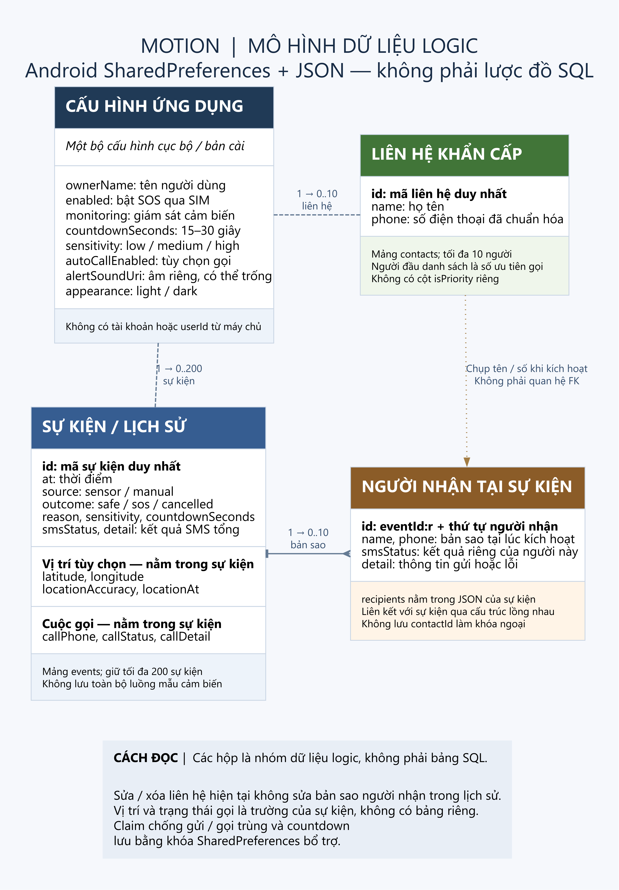
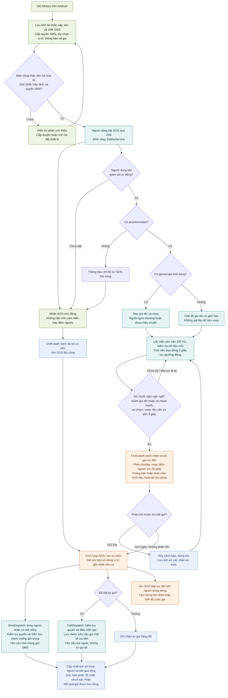

# Motion

Ứng dụng Flutter giám sát dấu hiệu té ngã, cảnh báo xác nhận và hỗ trợ SOS trên Android. **Phiên bản test: 1.0.2+4** · Nhóm dự kiến **50–100 người test**.

Tất cả hướng dẫn cài đặt, sử dụng và phát triển nằm ngay trong README này. Người test chỉ cần điện thoại Android; không cần tải source hay cài công cụ lập trình.

**Xem nhanh:** [ERD dữ liệu](#sơ-đồ-thực-thể-erd) · [Luồng hoạt động](#luồng-hoạt-động-của-hệ-thống) · [Hướng dẫn sử dụng](#hướng-dẫn-sử-dụng-sau-khi-cài-đặt).

## Tải APK để tham gia test (không cần máy tính)

Quét QR bằng điện thoại **Android** hoặc bấm **[Tải Motion 1.0.2 — APK](https://github.com/Vinh-205/Motion/releases/download/v1.0.2-test.4/Motion-1.0.2-android.apk)**. Mã QR trỏ trực tiếp đến cùng tệp APK trên GitHub Releases, không cần đăng nhập GitHub.

[](https://github.com/Vinh-205/Motion/releases/download/v1.0.2-test.4/Motion-1.0.2-android.apk)

1. Tải tệp `Motion-1.0.2-android.apk` (khoảng 54 MB). Đây là bản test Android 7.0 trở lên, không dùng cho iPhone.
2. Mở tệp đã tải → nếu Android yêu cầu, cho phép **Cài ứng dụng không rõ nguồn gốc / Cho phép từ nguồn này** cho trình duyệt hoặc ứng dụng quản lý tệp đang mở APK → nhấn **Cài đặt**. Có thể tắt lại quyền cài từ nguồn này sau khi cài xong.
3. Mở Motion và làm theo **[Hướng dẫn sử dụng bên dưới](#hướng-dẫn-sử-dụng-sau-khi-cài-đặt)**. Người test không cần cài Flutter, Android Studio hay bật USB debugging.

Nếu đã có Motion, hãy thử cài cập nhật. Nếu báo xung đột chữ ký, có thể bản cũ là debug; ghi lại liên hệ/cấu hình trước khi quyết định gỡ bản cũ vì gỡ app sẽ xóa dữ liệu cục bộ. Không bỏ qua cảnh báo bảo mật chưa hiểu rõ; gửi ảnh lỗi cho người phát triển để kiểm tra.

Đây là bản phát hành thử dành cho nhóm dự kiến 50–100 người. Mỗi máy tự cấu hình liên hệ/SIM; không có tài khoản hay hệ thống thu thập phản hồi tự động. Không tự dùng số của người tổ chức làm người nhận SOS cho cả nhóm. Thống nhất trước với người nhận khi thử SMS hoặc cuộc gọi thật vì có thể phát sinh cước.

[Trang bản test, thông tin tệp và ghi chú phát hành](https://github.com/Vinh-205/Motion/releases/tag/v1.0.2-test.4). QR này cố định ở bản 1.0.2+4, không tự chuyển sang bản mới.

## Bản sửa 1.0.2 — kiểm tra lại trên điện thoại

- **Cảm biến:** yêu cầu 100 Hz thay cho 20 Hz; màn hình Theo dõi hiển thị Hz thực tế, bước đang kiểm tra và ngưỡng va chạm hiện tại. Vẫn xem số đo gia tốc khi chưa bật SOS; điều này không có nghĩa giám sát nền đã bật.
- **Máy thiếu gyroscope:** thử nguồn gyroscope chưa hiệu chuẩn nếu có (trừ bias do cảm biến báo). Nếu không có, dùng chế độ gia tốc riêng và ghi rõ giới hạn; không chặn quyền SMS chỉ vì thiếu con quay. Không có accelerometer thì chỉ hỗ trợ SOS thủ công.
- **SMS:** có nút CẤP QUYỀN SMS và MỞ CÀI ĐẶT QUYỀN SMS trong thiết lập SOS. Quyền SMS được xin riêng trước các quyền tùy chọn; cuộc gọi không chứng minh SMS đã gửi. Nếu quyền bị khóa/không có trong cài đặt, trình cài đặt hoặc chính sách Android có thể hạn chế. App không tự vượt được giới hạn này. Xem trạng thái/mã Android từng người trong Lịch sử.
- **Âm báo:** chuông SOS Motion được đóng gói sẵn, phát ngoại tuyến và lặp lại. Nếu đang chọn âm riêng, bấm DÙNG CHUÔNG SOS MOTION trong Cài đặt rồi Nghe thử; không tự xóa lựa chọn âm đã lưu.
- **Liên hệ:** bấm Thêm liên hệ mới sẽ cuộn tới ô nhập và mở bàn phím; sửa lỗi bố cục nút số khẩn cấp trên màn hình nhỏ.
- **Thông tin máy:** phần thiết lập SOS/kiểm tra thiết bị hiển thị model và phiên bản Android để chụp lại khi báo lỗi.

Ưu tiên thử lại quyền SMS với một người nhận đã đồng ý, trước khi thử cả danh sách. Nếu không nhận tin, gửi mẫu máy/Android và chi tiết lỗi SMS trong Lịch sử; chưa thể xác nhận đã khắc phục gửi thật chỉ bằng kiểm thử máy ảo. Không thử bằng cách thả rơi điện thoại hoặc cố ngã.

## Hướng dẫn sử dụng sau khi cài đặt

### Bước 1 — Làm quen giao diện

App có bốn mục **Theo dõi**, **Lịch sử**, **Liên hệ**, **Cài đặt**. Nút mặt trời/mặt trăng trên thanh đầu dùng để đổi giao diện sáng/tối. Lần đầu chưa thiết lập sẽ hiện **Chưa bật SOS**; chỉ mở app chưa có nghĩa đã bắt đầu giám sát.

### Bước 2 — Thêm liên hệ khẩn cấp

Vào **Liên hệ** → thêm tên và số điện thoại hoặc chọn liên hệ từ thiết bị → lưu. Có thể thêm nhiều người (tối đa 10). Kiểm tra số và thông báo trước cho từng người nhận. Khi SOS được kích hoạt, SMS sẽ được yêu cầu gửi đến các liên hệ đã chốt cho sự kiện đó.

Chọn biểu tượng điện thoại cạnh một người để đặt **liên hệ gọi ưu tiên**. App chỉ yêu cầu gọi một người trong một sự kiện, không lần lượt gọi cả danh sách và không tự gọi lại. Các số 113/114/115 là nút mở trình gọi để người dùng chủ động thao tác, không nằm trong danh sách tự động.

### Bước 3 — Thiết lập SOS, âm thanh và thời gian xác nhận

Vào **Cài đặt → Thiết lập SOS qua SIM**, điền thông tin được yêu cầu, chọn SIM và cấp quyền SMS/vị trí theo hướng dẫn trên app. Bật vị trí của điện thoại nếu muốn đính kèm tọa độ; độ chính xác phụ thuộc tín hiệu và quyền đã cấp.

Nếu muốn gọi cùng đợt gửi tin, bật **Tự gọi cùng lúc gửi SOS**, đọc xác nhận và cấp quyền gọi. Đây là tùy chọn riêng. Kiểm tra SIM thoại mặc định trong Android. App yêu cầu loa ngoài nhưng cách xử lý còn phụ thuộc thiết bị. Người nhận cần bắt máy mới có thể trò chuyện.

Chọn thời gian xác nhận phù hợp (ví dụ 30 giây), độ nhạy và âm thanh cảnh báo. Nhấn **Nghe thử** để kiểm tra loa/âm lượng; thao tác này không gửi SMS hoặc gọi. Độ nhạy cao có thể làm tăng cảnh báo giả; không điều chỉnh theo kỳ vọng chỉ cần lắc máy là có cảnh báo.

### Bước 4 — Bắt đầu và dừng giám sát

Từ **Theo dõi**, mở **Bắt đầu giám sát**, kiểm tra các mục thiết lập và nhấn bắt đầu. Cho phép các quyền cần thiết; các quyền mở màn hình cảnh báo và cài đặt pin cần làm theo hướng dẫn riêng trên thiết bị.

Sau khi app xác nhận dịch vụ đang chạy, có thể về Home hoặc khóa màn hình. Kiểm tra thông báo giám sát còn hiện. Không force-stop app. Sau khi khởi động lại máy, mở Motion và bắt đầu lại. Muốn kết thúc phiên, quay lại app và tắt giám sát; tránh chỉ đóng giao diện rồi cho rằng đã dừng.

### Bước 5 — Xử lý khi có cảnh báo

- Nếu an toàn, nhấn **TÔI ỔN** trước khi hết đếm ngược để hủy SOS của cảnh báo đó.
- Nếu cần trợ giúp, dùng nút gửi trợ giúp ngay hoặc chờ hết thời gian. App yêu cầu gửi SMS có thông tin vị trí nếu lấy được; tùy chọn gọi ưu tiên được thực hiện trong cùng đợt.
- Âm SOS tiếp tục sau khi yêu cầu gửi tin, kể cả khi SMS lỗi. Có thể dừng âm theo điều khiển trên app/thông báo. Âm thanh có cơ chế tạm dừng khi nhận thấy chế độ cuộc gọi; âm lượng, DND và hệ điều hành vẫn ảnh hưởng kết quả.
- Muốn kết thúc cuộc gọi đã chuyển sang Android, dùng nút kết thúc trong giao diện điện thoại. Đóng cảnh báo Motion không tự cúp cuộc gọi đã thực hiện.

### Bước 6 — Kiểm tra lịch sử

Vào **Lịch sử**, chọn sự kiện để xem thời gian, lý do kích hoạt, vị trí và trạng thái từng người nhận. **Đã gửi** không đồng nghĩa người nhận đã đọc; trạng thái cuộc gọi **đã yêu cầu** không xác nhận đã kết nối hoặc bắt máy. Nếu lỗi, kiểm tra quyền, SIM, sóng và tài khoản nhà mạng trước khi chủ động thử lại.

## Checklist dành cho nhóm test 50–100 người

1. Kiểm tra mở app, đổi sáng/tối, bốn tab, thêm/sửa liên hệ và nghe thử âm thanh.
2. Kiểm tra thiết lập quyền, bắt đầu giám sát, về Home, khóa/mở máy rồi quay lại app và dừng giám sát.
3. Chỉ thử SOS thật sau khi đã thống nhất với người nhận. Không dùng số cơ quan khẩn cấp để thử. Không cố ngã hay thả rơi điện thoại để kích hoạt cảm biến. Bản release không có nút mô phỏng.
4. Khi thử SOS thủ công, kiểm tra người nhận có SMS/vị trí và cuộc gọi tùy chọn hay không; kết thúc cuộc gọi và dừng âm sau phép thử. SOS thủ công không chứng minh độ chính xác phát hiện té ngã.
5. Gửi phản hồi tại **[GitHub Issues](https://github.com/Vinh-205/Motion/issues)** nếu có tài khoản, hoặc gửi trực tiếp người tổ chức qua kênh đã thống nhất. Ghi mẫu máy, phiên bản Android, phiên bản Motion, bước thao tác, kết quả mong đợi/thực tế và ảnh lỗi. Không công khai số điện thoại, vị trí GPS hay tin nhắn riêng tư; che chúng trước khi đăng ảnh.

Trước đây người dùng đã xác nhận SMS/vị trí trên một máy, nhưng đợt test mới có máy không gửi được; cần kiểm tra quyền và kết quả từng người nhận. Cuộc gọi thật, chạy nền dài hạn và độ chính xác phát hiện cần được kiểm chứng thêm trên từng thiết bị; app không bảo đảm phát hiện mọi cú ngã và không thay thế việc gọi trợ giúp chủ động khi có thể.

## Tổng quan hệ thống

Motion gồm giao diện Flutter, cầu nối MethodChannel và dịch vụ Android native. Khi SOS thật đã bật, **SafetyService** quản lý cảm biến, thời hạn xác nhận và yêu cầu gửi/gọi ngay cả khi giao diện Flutter không ở phía trước. Dữ liệu nằm trên từng điện thoại; không có tài khoản hay máy chủ xử lý SOS chung.

### Sơ đồ thực thể ERD

Đây là **ERD logic của dữ liệu hiện có**, không phải các bảng SQL. `SafetyStore` lưu cấu hình bằng SharedPreferences, còn danh sách liên hệ và sự kiện là JSON. Vị trí và kết quả cuộc gọi nằm trong sự kiện, không có bảng riêng.



| Nhóm dữ liệu | Vai trò |
| --- | --- |
| Cấu hình ứng dụng | Tên người dùng, bật SOS/giám sát, độ nhạy, thời gian chờ, âm báo và giao diện |
| Liên hệ khẩn cấp | Tối đa 10 người; người đầu danh sách là số ưu tiên gọi |
| Sự kiện / lịch sử | Tối đa 200 sự kiện, gồm lý do, kết quả, vị trí tùy chọn và trạng thái gọi |
| Người nhận tại sự kiện | Bản sao tên/số và kết quả SMS của từng người tại lúc kích hoạt |

**Bản sao người nhận không phải liên kết sống với danh bạ.** Sửa hoặc xóa liên hệ hiện tại không sửa người nhận trong lịch sử hay danh sách đã chốt của cảnh báo đang xử lý. Mỗi lần gửi/gọi có claim bền vững để tránh tự gửi/gọi trùng khi tiến trình khởi động lại.

[Ảnh PNG đầy đủ](docs/images/motion-erd.png) · [Bản vector SVG](docs/images/motion-erd.svg) · [Source ERD Graphviz](docs/diagrams/motion-erd.dot).

### Luồng hoạt động của hệ thống

Luồng dưới đây mô tả bản dùng thật: **SOS thủ công gửi ngay**, còn nhánh cảm biến phải hoàn thành chuỗi nghi ngờ và bước xác nhận. Hai nhánh dùng chung cơ chế SMS, gọi ưu tiên, âm báo và lịch sử.



SMS gửi cho cả danh sách đã chốt; cuộc gọi chỉ đến một số ưu tiên nếu đã bật. Hai luồng xử lý độc lập: lỗi gọi không chặn SMS và không chờ cuộc gọi kết thúc mới gửi tin. Không lấy được vị trí vẫn gửi nội dung cảnh báo. Âm thanh là âm trên máy chạy Motion, không phải tệp âm đính kèm SMS.

Thông báo, mở toàn màn hình và giám sát nền phụ thuộc quyền/cơ chế Android. Dừng dịch vụ hoặc hệ thống chặn khởi chạy thì không coi là đang giám sát. Khi người dùng về Home, dịch vụ vẫn tiếp tục nếu còn được Android cho chạy; không tự bật lại giám sát sau khi khởi động điện thoại. Trạng thái gửi/gọi không chứng minh người thân đã đọc tin hoặc bắt máy.

[Source Mermaid](docs/diagrams/motion-flow.mmd). Đối chiếu triển khai tại [SafetyService](android/app/src/main/kotlin/com/example/cam_bien_te_nga/SafetyService.kt), [SafetyStore](android/app/src/main/kotlin/com/example/cam_bien_te_nga/SafetyStore.kt), [SmsDispatch](android/app/src/main/kotlin/com/example/cam_bien_te_nga/SmsDispatch.kt) và [CallDispatch](android/app/src/main/kotlin/com/example/cam_bien_te_nga/CallDispatch.kt).

## Cài môi trường phát triển và chạy source

Phần này dành cho người muốn mở source trong VS Code hoặc tự build APK. Người cài APK qua QR có thể bỏ qua.

### 1. Chuẩn bị trên Windows

- Cài Git for Windows, Flutter SDK, Android Studio và VS Code.
- Thêm thư mục `flutter/bin` vào PATH; mở terminal mới sau khi chỉnh PATH.
- Project yêu cầu **Dart ^3.13.3**; môi trường đã dùng là **Flutter 3.47.4 / Dart 3.13.3**. Giữ `pubspec.lock` khi clone.
- Trong Android Studio → SDK Manager, cài SDK Platform 36, Platform-Tools, Command-line Tools và Android Emulator. Nếu log yêu cầu NDK, cài đúng phiên bản (môi trường hiện tại dùng 28.2.13676358).
- Dùng JDK kèm Android Studio; không cần cài Gradle riêng.
- Trong VS Code, cài extension **Flutter** (kèm Dart). Extension không thay thế Flutter SDK.

```powershell
git --version
flutter --version
flutter doctor -v
flutter doctor --android-licenses
```

Đọc và chấp nhận license nếu đồng ý. Sửa lỗi Android toolchain mà doctor báo. Cảnh báo thiếu Visual Studio chỉ liên quan build Windows desktop.

### 2. Tải source

```powershell
git clone https://github.com/Vinh-205/Motion.git
cd Motion
flutter pub get
code .
```

Nếu không dùng được `code .`, mở VS Code → File → Open Folder → chọn thư mục Motion. Thư mục đang mở phải chứa `pubspec.yaml`, không chỉ thư mục android.

Không sao chép `android/local.properties` từ máy khác. Flutter tạo đường dẫn SDK riêng cho máy hiện tại. Không cần npm install để chạy app vì dữ liệu icon đã được tạo sẵn.

### 3. Chạy máy ảo trong VS Code

1. Android Studio → Device Manager → tạo máy ảo, chọn image phù hợp CPU và nhấn Play. Có thể chọn Pixel 7; chờ Android khởi động xong.
2. VS Code → bấm tên thiết bị trên thanh trạng thái dưới cùng → chọn máy ảo Android. Hoặc Ctrl+Shift+P → Flutter: Select Device.
3. Mở `lib/main.dart`, nhấn F5. Build đầu cần Internet và có thể mất vài phút.
4. Sửa giao diện rồi lưu để hot reload; sau thay đổi native/plugin cần dừng phiên chạy và chạy lại.

```powershell
flutter devices
flutter run -d emulator-5554
```

Thay emulator-5554 bằng ID thực tế. Máy ảo dùng để kiểm tra giao diện; không chứng minh SMS/cuộc gọi qua SIM thật. Nếu Failed to launch, mở máy ảo bằng Device Manager hoặc Flutter: Launch Emulator → cold boot, chờ khởi động rồi chọn lại thiết bị.

### 4. Chạy điện thoại thật từ source

1. Dùng Android có accelerometer và gyroscope; môi trường hiện tại có minSdk 24 (Android 7.0 trở lên).
2. Bật Developer options → USB debugging, kết nối cáp có truyền dữ liệu và đồng ý thông báo cho phép debug.
3. Chạy `flutter devices`, rồi `flutter run -d <device-id>` với ID điện thoại; hoặc chọn thiết bị trong VS Code và nhấn F5.
4. Sau khi cài, thực hiện phần **Hướng dẫn sử dụng sau khi cài đặt** phía trên để cấu hình SOS.

### 5. Kiểm tra và build APK debug

Tại thư mục chứa pubspec.yaml:

```powershell
flutter analyze
flutter test
flutter build apk --debug
```

APK: `build/app/outputs/flutter-apk/app-debug.apk`. Chép sang điện thoại, cho phép cài ứng dụng từ nguồn tương ứng khi Android yêu cầu rồi mở APK để cài. Đây là bản debug thử nghiệm.

Kiểm thử tích hợp nằm trong integration_test; chỉ chạy theo kịch bản dry-run đã kiểm soát. Kiểm thử tự động không thay thế xác minh SIM và giám sát dài hạn trên máy thật.

### 6. Build release

Bản clone mới không có khóa ký và mật khẩu. Chủ dự án cần khôi phục riêng đúng khóa đã dùng và cấu hình `android/key.properties` trước khi build:

```powershell
flutter build apk --release
flutter build appbundle --release
```

- APK: `build/app/outputs/flutter-apk/app-release.apk`.
- AAB: `build/app/outputs/bundle/release/app-release.aab`.
- Khóa hiện tại: `android/keystore/motion-release.jks`; cấu hình: `android/key.properties`. Hai tệp này không nằm trên GitHub.

Chỉ chạy source bằng debug thì không cần khóa release. Không tạo khóa mới để cập nhật bản release đã cài: Android yêu cầu chữ ký phù hợp. Debug và release khác chữ ký nên có thể không cài đè. Gỡ app sẽ mất dữ liệu cục bộ; cần lưu cấu hình trước khi tự thực hiện.

Xem phần **Mức độ đã kiểm chứng và giới hạn** bên dưới. Build thành công chưa đồng nghĩa được cửa hàng duyệt.

### 7. Lỗi thường gặp

| Hiện tượng | Cách xử lý |
| --- | --- |
| Không nhận lệnh Flutter | Kiểm tra PATH và mở terminal mới |
| Dart không tương thích | Kiểm tra flutter --version; dùng SDK đáp ứng pubspec.yaml |
| Không thấy thiết bị | Kiểm tra máy ảo/USB debugging, cáp và driver; chạy flutter devices |
| Thiếu SDK/NDK/license | Đọc log, cài đúng thành phần trong SDK Manager |
| Kotlin lỗi cache khác ổ C/D | Giữ kotlin.incremental=false trong android/gradle.properties |
| Release lỗi khóa ký | Khôi phục khóa và key.properties riêng; hoặc build debug |
| Không gửi SMS/gọi | Dùng máy thật, kiểm tra SIM/sóng/quyền, cấu hình SOS và lịch sử |
| Không cài đè bản cũ | Kiểm tra chữ ký và versionCode trước khi thay đổi dữ liệu |

### 8. Cập nhật source

```powershell
git remote -v
git pull --ff-only origin main
flutter pub get
```

Origin phải trỏ đến `https://github.com/Vinh-205/Motion.git`. Chỉ pull khi thay đổi cục bộ đã được lưu/commit phù hợp. Giữ khóa ký, mật khẩu, SDK riêng, cache và build ngoài Git.


## Chức năng và cách SOS hoạt động

- Giám sát cảm biến bằng dịch vụ nền Android sau khi người dùng bắt đầu giám sát. Chưa thiết lập thì hiển thị **Chưa bật SOS**, không tạo SOS giả. Bản release không có nút mô phỏng.
- Khi phát hiện chuỗi nghi ngờ, app báo âm/rung và đếm ngược theo thời gian đã chọn. Hủy trước hạn bằng **TÔI ỔN**; nếu không phản hồi, yêu cầu gửi SMS thật qua SIM.
- Tối đa 10 liên hệ; danh sách người nhận và số gọi ưu tiên được chốt khi cảnh báo bắt đầu. Sửa danh sách sau đó áp dụng cho sự kiện tiếp theo. Không xóa được người nhận cuối cùng khi SOS qua SIM còn bật.
- SMS có tên, thời điểm, nội dung cảnh báo và liên kết vị trí gần nhất nếu có, kèm thời điểm/sai số. Không có vị trí vẫn gửi cảnh báo. SMS không chứa tệp âm thanh; âm SOS phát trên điện thoại chạy Motion. Nội dung không dấu giúp giảm số phần SMS; nhà mạng có thể tính phí từng phần/người nhận.
- Mỗi người nhận có kết quả riêng; một người lỗi không ngăn các người còn lại. Mã sự kiện/claim được lưu trước khi chạm API để tránh gửi/gọi lặp khi tiến trình khởi động lại. Khi chưa rõ kết quả, ghi nhận chưa xác nhận thay vì tự gửi lại.
- Tự gọi mặc định tắt, cần đồng ý và quyền CALL_PHONE riêng. Một SOS yêu cầu gọi một lần đến số ưu tiên; không tự gọi lại, không gọi tuần tự. Lỗi cuộc gọi không chặn SMS. SIM thoại mặc định có thể khác SIM SMS. App không đọc nhật ký, không ghi âm và không đọc thông báo bằng giọng nói trong cuộc gọi.
- Chọn liên hệ bằng trình chọn Android, không xin quyền đọc toàn bộ danh bạ. Không xin quyền đọc SMS hoặc nhật ký cuộc gọi. Liên hệ, cấu hình và tối đa 200 sự kiện thật lưu trong vùng riêng ứng dụng trên Android; gỡ app làm mất dữ liệu cục bộ.
- Thông báo có thao tác **TÔI ỔN**, **MỞ CẢNH BÁO**, **DỪNG ÂM SOS** theo trạng thái. Android quyết định mở toàn màn hình hay thông báo nổi; không vượt khóa bảo mật, không dùng overlay/Accessibility. Không mở được giao diện vẫn xử lý countdown/SMS nếu dịch vụ còn hoạt động.
- Chuông SOS Motion mặc định là âm do dự án tự tổng hợp, được đóng gói trong `android/app/src/main/res/raw/motion_sos.wav`; có thể tạo lại bằng `python tool/generate_sos_alarm.py`. Âm thanh dùng luồng báo thức, không tự tăng âm lượng hoặc bỏ qua DND. Chọn âm từ danh sách Android; hủy giữ nguyên âm trước. Nếu âm không còn đọc được, thử âm mặc định rồi âm dự phòng. **Nghe thử · 3 giây** không tạo SOS. Animation khởi động chỉ phát khi mở mới thông thường, bỏ qua khi có SOS/giảm chuyển động.

### Hiểu trạng thái

| Trạng thái | Ý nghĩa |
| --- | --- |
| Đang xử lý | Chưa biết kết quả cuối cùng |
| SMS đã gửi | Android xác nhận đã gửi các phần tin đến nhà mạng, không chứng minh đã đọc |
| Có báo phát | Nhà mạng báo phát các phần tin, không chứng minh người thân đang trợ giúp |
| Một phần thành công | Các người nhận có kết quả khác nhau; xem chi tiết từng người |
| Thất bại / chưa xác nhận | Có lỗi hoặc thiếu phản hồi; không tự coi là thành công |
| Đã yêu cầu Android gọi | Đã chuyển yêu cầu, không xác nhận đã kết nối hoặc bắt máy |

## Mức độ đã kiểm chứng và giới hạn

| Hạng mục | Bằng chứng / việc còn cần thử |
| --- | --- |
| Giao diện, liên hệ, sáng/tối, lịch sử, âm thanh | Có chức năng và kiểm thử tự động |
| Cảm biến, countdown, SMS nhiều người, gọi đúng số đã chốt | Có kiểm thử logic/native dry-run; không chạm API gửi/gọi thật trong dry-run |
| SMS và vị trí thật | Trước đây có máy gửi thành công; đợt test 27/10/2026 báo có máy không gửi. Bản 1.0.2 sửa luồng quyền và chẩn đoán lỗi; cần xác nhận lại trên máy bị lỗi |
| Cuộc gọi thật | Người dùng báo đã có cuộc gọi đi; kết nối/loa/SIM vẫn cần kiểm chứng trên từng máy |
| Phát hiện té ngã thực tế | Chưa đo tỷ lệ bỏ sót/báo giả trên tập dữ liệu thực tế |
| Giám sát dài hạn/khóa máy | Cần thử theo thiết bị; force-stop, khởi động lại, thu hồi quyền, lỗi SIM/sóng và tiết kiệm pin có thể làm gián đoạn |
| Phát hành cửa hàng | Chưa tải lên hoặc được Google Play/App Store duyệt; GitHub Releases là kênh phân phối bản test |

**AN TOÀN** chỉ có nghĩa chưa ghi nhận chuỗi nghi ngờ; không xác nhận sức khỏe hay tình trạng tỉnh táo. App không phải thiết bị y tế và không bảo đảm phát hiện mọi cú ngã.

Trước khi phát hành công khai: kiểm chứng SMS/cuộc gọi thật với người nhận đồng ý; kiểm tra nền, pin, DND và full-screen trên thiết bị đích; thu thập dữ liệu để đánh giá thuật toán; chuẩn bị chính sách quyền riêng tư và khai báo quyền SMS/foreground service theo yêu cầu cửa hàng. Không mặc nhiên được duyệt vì đã build release.

Mã gói hiện tại: `com.example.cam_bien_te_nga`. Cần chốt mã gói trước lần phát hành cửa hàng đầu tiên. Sao lưu khóa ký và cấu hình riêng để cập nhật các bản release; không đưa lên GitHub.

## Ghi chú kỹ thuật

### Thuật toán cảm biến

Thuật toán dùng tổng `sqrt(x*x + y*y + z*z)`, không dùng ngưỡng riêng cho trục X/Y/Z:

`normal → possibleFall → impactDetected → waitingForStillness → fallSuspected`.

Cần bất thường → mẫu va chạm đến sau trong 1,5 giây → bằng chứng xoay trong 1,5 giây sau va chạm → ít chuyển động liên tục 3 giây; hoàn tất trong cửa sổ 8 giây. Với con quay, va chạm cần có pha gia tốc thấp < 5 m/s² ít nhất 40 ms trước đó, hoặc mạnh hơn ngưỡng động ít nhất 6 m/s². Không có con quay: bắt buộc pha gia tốc thấp ít nhất 80 ms, va chạm rồi yên 3 giây; kiểm tra thêm biến đổi vector gia tốc để không coi chuyển động đều là nằm yên. Nhánh gia tốc có thể bỏ sót ngã không có pha giảm gia tốc. Một đỉnh rung đơn lẻ không đủ. Tích phân độ lớn gyroscope là bằng chứng xoay, không phải góc tư thế tuyệt đối.

Ngưỡng sàn thử nghiệm trong `lib/models/detection_config.dart` và bộ phát hiện native:

| Độ nhạy | Lệch gia tốc khỏi 9,81 m/s² | Va chạm | Tích phân độ lớn gyro |
| --- | ---: | ---: | ---: |
| Thấp | > 5 m/s² | ≥ 27 m/s² | ≥ 0,90 rad |
| Trung bình | > 4 m/s² | ≥ 23 m/s² | ≥ 0,65 rad |
| Cao | > 3 m/s² | ≥ 20 m/s² | ≥ 0,45 rad |

Bất thường khác: magnitude < 5 m/s² hoặc gyro > 1,5 rad/s. Ít chuyển động: lệch gia tốc < 1,3 m/s² và gyro < 0,35 rad/s. Lấy mẫu yêu cầu khoảng 100 Hz; gap > 400 ms hoặc gyro cũ > 250 ms bị loại. Sau sự kiện có khoảng nghỉ 8 giây. Máy có con quay rơi thiếu xoay, được nhặt lên sớm hoặc đỉnh va chạm quá ngắn có thể không thỏa chuỗi; không kết luận cần hạ ngưỡng chỉ từ một lần thử.

Trên emulator có thể mở **Extended Controls → Virtual Sensors → Device Pose** để quan sát dữ liệu. Xoay rồi giữ yên vẫn có magnitude gần 9,81 m/s² vì trọng lực. Emulator không tái tạo đầy đủ một cú té. Mô phỏng chỉ dành cho test bật rõ `allowSimulation`, bị khóa trong release; không dùng để vận hành thật.

### Phân biệt đi lại và nghi ngờ ngã

Không phân loại bằng tốc độ con quay hoặc một trục riêng. Gia tốc tổng có đơn vị m/s²; con quay đo rad/s. Trong cửa sổ 2 giây trước mẫu hiện tại, tính trung bình μ và độ lệch chuẩn σ của độ lớn gia tốc; sau khi đủ dữ liệu (ít nhất 20 mẫu và 0,5 giây), ngưỡng va chạm là `max(ngưỡng sàn theo độ nhạy, μ + 3σ)`. Mẫu va chạm hiện tại không tham gia tính ngưỡng của chính nó. Đây là heuristic thử nghiệm, không phải ngưỡng lâm sàng đã được xác thực.

| Tình huống | Cách xử lý |
| --- | --- |
| Đi bộ/chạy có dao động lặp lại | Cập nhật nền dao động, không coi rung đơn lẻ là ngã |
| Va chạm lặp lại sau khoảng ổn định ban đầu 300 ms | Bỏ ứng viên ngã cũ và giữ nền dao động, không tích lũy nhiều bước chân thành một cú ngã |
| Có chuỗi ngã nhưng vẫn tiếp tục cử động | Chưa đủ bước ít chuyển động, không tự khẳng định ngã |
| Chuỗi đủ pha giảm gia tốc/va chạm/xoay nếu có, rồi yên 3 giây | Mở cảnh báo xác nhận; SMS chỉ sau thời gian chờ nếu không hủy |
| Mất dữ liệu/gyro quá cũ trên máy có gyro | Bỏ chuỗi, báo tình trạng dữ liệu thay vì giả định đã giám sát |

Bộ kiểm thử có dữ liệu tổng hợp 100 Hz: đi bộ 2 Hz, chạy 3 Hz, các đỉnh bước chân 28 m/s² lặp mỗi 400 ms rồi dừng, và một va chạm ngã mạnh hơn sau khi chạy. Kết quả chỉ chứng minh hành vi trên các chuỗi đó, chưa đo độ nhạy/độ đặc hiệu thực tế. Cần dữ liệu từ vị trí đeo/túi và từng máy để hiệu chỉnh tiếp.

### Kiểm thử native và tích hợp

Sau khi Flutter đã tạo Gradle wrapper trên máy, có thể chạy:

```powershell
# Dùng JDK kèm Android Studio; sửa đường dẫn nếu máy cài ở nơi khác.
$env:JAVA_HOME = 'C:\Program Files\Android\Android Studio\jbr'
.\android\gradlew.bat -p android :app:testDebugUnitTest --console=plain
flutter test integration_test/device_safety_test.dart -d emulator-5554
```

Integration test chỉ chạy khi SOS thật đang tắt. Dry-run chặn cả API SMS và Telecom, không xin quyền gửi/gọi; tạm cấu hình số thử, kiểm tra countdown/danh sách chốt và khôi phục cấu hình trong `finally`. Các điểm vào dry-run chỉ có ở debug. Kết quả kiểm chứng gần nhất của mã app: 69 Flutter tests, 14 Kotlin tests và 1 integration dry-run đạt; không đại diện mọi điện thoại.

### Icon và animation morphicons trong Flutter

Toàn bộ icon do ứng dụng Flutter tự vẽ dùng dữ liệu vector Lucide và kế hoạch chuyển hình tạo bởi **morphicons 2.0.0**. Gói npm không có widget Flutter chính thức; dự án dùng lõi pure-JavaScript khi sinh mã, rồi vẽ native qua Flutter CustomPainter. Không có WebView, CDN hoặc JavaScript runtime trong APK. Icon của hộp thoại hệ thống, bàn phím và trình danh bạ do Android quản lý.

- `tool/morphicons/package.json` và `package-lock.json`: khóa morphicons 2.0.0, Lucide 1.57.0.
- `tool/morphicons/generate.mjs`: dùng `iconToCubics`, `resampleIcon`, `buildPlan`, `interpPolar`, `SPRING_PRESETS` thật của morphicons.
- `lib/generated/morphicons_data.g.dart`: 38 icon vector, 24 kế hoạch morph và preset spring; được commit để Flutter build không cần npm. Bao gồm cặp mặt trời/mặt trăng cho nút sáng/tối.
- `lib/widgets/morph_icon.dart`: dựng đường cubic chính xác khi đứng yên, nội suy polar và block transport theo dữ liệu đã sinh khi chuyển trạng thái. Có hiệu ứng vẽ nét khi xuất hiện, morph có thể đảo giữa chừng và hỗ trợ giảm chuyển động của hệ điều hành.
- `test/fixtures/morphicons_reference.json`: tọa độ tham chiếu do thư viện npm tạo, bao gồm overshoot.
- `test/morph_icon_test.dart`: đối chiếu renderer Flutter với chính đầu ra npm, kiểm tra tất cả glyph, đảo animation và giảm chuyển động.
- Android launcher/notification dùng vector từ cùng nguồn Lucide, sinh cùng lúc với dữ liệu Flutter.

#### Sinh lại khi thay icon

```powershell
Set-Location tool/morphicons
npm ci --ignore-scripts
npm run generate
Set-Location ../..
flutter test test/morph_icon_test.dart
```

Thêm icon trong bảng `glyphs` của generator và enum `AppGlyph`; thêm cặp state trong `pairs` nếu cần morph. Dùng `MorphIcon(AppGlyph.play, alternate: AppGlyph.pause, active: playing)`; thay `active` sẽ chạy spring theo preset của morphicons. Nút hành động morph khi nhấn; bốn mục điều hướng có cặp hình inactive/active riêng.

Giữ `THIRD_PARTY_NOTICES.md` cùng dự án. MIT của morphicons và ISC của Lucide nằm trong file này và được đưa vào màn hình giấy phép của Flutter.

Nguồn: https://www.morphicons.com/docs · https://github.com/guillermolg00/morphicons

### Nguồn animation khởi động

`assets/animations/motion_startup.json` được biến tấu từ **Smart TB.json** do người dùng cung cấp tại `D:/Downloads/Smart TB.json`.

- SHA-256 của file nguồn: `7efef030398d1d3043e24a4d72758149738c47771a69a2278a8031156dc4a0c8`.
- Giữ 5 lớp vector chấm tròn với quỹ đạo xoay và nhịp trễ của bản gốc.
- Bỏ precomposition, logo, chữ và toàn bộ ảnh bitmap của ứng dụng gốc.
- Chỉnh bán kính quỹ đạo, kích thước chấm, màu và khoảng phát thành 110 frame / 60 fps; file còn khoảng 6 KB.
- Flutter dùng `lottie` để phát asset ngoại tuyến, đổi màu qua `LottieDelegates`, bổ sung logo Morphicons và chữ Motion bằng widget native.
- Animation dài 1.85 giây, chỉ khi mở mới thông thường. Giám sát khởi động đồng thời. SOS, ngữ cảnh mở khẩn hoặc chế độ giảm chuyển động bỏ qua phần giới thiệu.
- Thời gian phát tính từ sau khung hình Flutter đầu tiên được rasterize. Android đưa cờ mở SOS qua initial route `/motion-alert` trước khi Dart chạy; không dùng timeout MethodChannel để quyết định bỏ qua animation.

Hai link tham khảo người dùng gửi:
https://app.lottiefiles.com/share/077eef8e-eac1-4cf5-82a6-e0f0020d1a9d
https://app.lottiefiles.com/share/c5f26bb7-5c30-4314-a49e-fb4aa0e8b91d

File JSON nguồn không có thông tin tác giả/giấy phép; tài liệu này ghi nhận nguồn do người dùng cung cấp, không gán giấy phép MIT của thư viện phát Lottie cho animation nguồn. Hai file gốc trong Downloads được giữ nguyên.


### Cấu trúc source

| Thư mục | Nội dung |
| --- | --- |
| `lib/` | Giao diện, trạng thái và logic Flutter |
| `android/` | Dịch vụ nền, cảm biến, SMS, cuộc gọi và âm thanh native |
| `assets/` | Tài nguyên animation |
| `test/`, `integration_test/`, `android/app/src/test/` | Kiểm thử |
| `tool/morphicons/` | Công cụ tạo icon, không cần npm khi chạy app bình thường |
| Các nền tảng khác | Khung Flutter; SOS native hiện triển khai cho Android |

Source/tài nguyên cần thiết nằm trên Git. Build, cache, SDK riêng, khóa ký và mật khẩu được bỏ qua. Hình launch iOS có thể thay trong Xcode → Runner → Assets.xcassets → LaunchImage.

### Giấy phép và tài liệu tham chiếu

[THIRD_PARTY_NOTICES.md](THIRD_PARTY_NOTICES.md) giữ riêng thông báo giấy phép bên thứ ba và được app sử dụng; đây không phải hướng dẫn sử dụng trùng lặp.

- [Android SMS API](https://developer.android.com/reference/android/telephony/SmsManager)
- [Quyền SEND_SMS và hạn chế của trình cài đặt](https://developer.android.com/reference/android/Manifest.permission#SEND_SMS)
- [Android Telecom API](https://developer.android.com/reference/android/telecom/TelecomManager)
- [Thông báo khẩn](https://developer.android.com/develop/ui/views/notifications/time-sensitive)
- [Foreground service](https://developer.android.com/develop/background-work/services/fgs/service-types)
- [Khai báo quyền SMS trên Google Play](https://support.google.com/googleplay/android-developer/answer/10208820)
- [Build và ký Android với Flutter](https://docs.flutter.dev/deployment/android)
