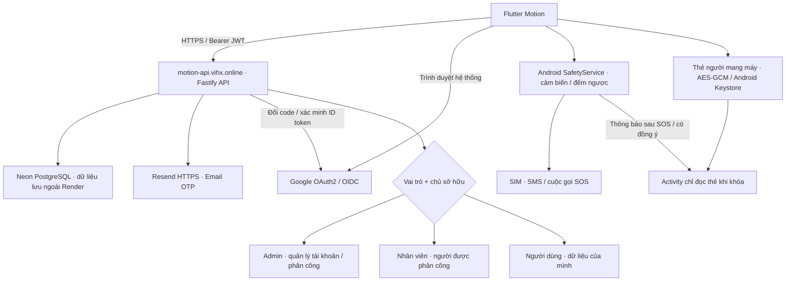
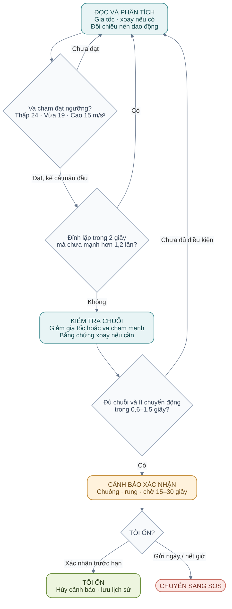
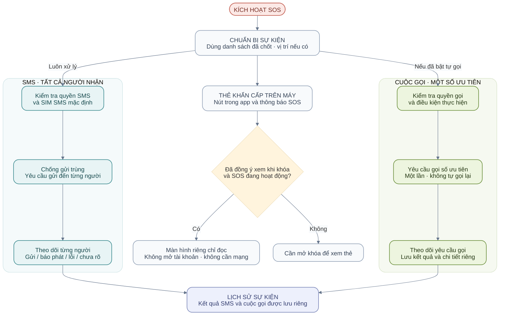

# Motion

**Source hiện tại: 1.1.4+10** · [API / Swagger công khai](https://motion-api.vihx.online/docs) · [Source GitHub](https://github.com/Vinh-205/Motion).


## Tải APK để tham gia test (không cần máy tính)

Quét QR bằng điện thoại **Android** hoặc bấm **[Tải Motion 1.1.4 — APK](https://github.com/Vinh-205/Motion/releases/download/v1.1.4-test.10/Motion-1.1.4-android.apk)**. Mã QR trỏ trực tiếp đến cùng tệp APK trên GitHub Releases, không cần đăng nhập GitHub.

[](https://github.com/Vinh-205/Motion/releases/download/v1.1.4-test.10/Motion-1.1.4-android.apk)

1. Tải tệp `Motion-1.1.4-android.apk` (khoảng 55 MB). Đây là bản test Android 7.0 trở lên, không dùng cho iPhone.
2. Mở tệp đã tải → nếu Android yêu cầu, cho phép **Cài ứng dụng không rõ nguồn gốc / Cho phép từ nguồn này** cho trình duyệt hoặc ứng dụng quản lý tệp đang mở APK → nhấn **Cài đặt**. Có thể tắt lại quyền cài từ nguồn này sau khi cài xong.
3. Mở Motion và làm theo **[Hướng dẫn sử dụng bên dưới](#hướng-dẫn-sử-dụng-sau-khi-cài-đặt)**. Người test không cần cài Flutter, Android Studio hay bật USB debugging.

Nếu đã có Motion, hãy thử cài cập nhật. Nếu báo xung đột chữ ký, có thể bản cũ là debug; ghi lại liên hệ/cấu hình trước khi quyết định gỡ bản cũ vì gỡ app sẽ xóa dữ liệu cục bộ. Không bỏ qua cảnh báo bảo mật chưa hiểu rõ; gửi ảnh lỗi cho người phát triển để kiểm tra.

Đây là bản phát hành thử dành cho nhóm dự kiến 50–100 người. Mỗi người đăng ký/đăng nhập bằng tài khoản riêng; mỗi máy tự cấu hình liên hệ, SIM và thẻ khẩn cấp. Chưa có hệ thống thu thập phản hồi tự động. Không tự dùng số của người tổ chức làm người nhận SOS cho cả nhóm. Thống nhất trước với người nhận khi thử SMS hoặc cuộc gọi thật vì có thể phát sinh cước.

[Trang bản test, thông tin tệp và ghi chú phát hành](https://github.com/Vinh-205/Motion/releases/tag/v1.1.4-test.10). QR đã cập nhật để tải đúng bản **1.1.4+10**. File cũ trong Downloads không tự đổi; hãy tải lại và kiểm tra phiên bản sau khi cài.

**Kiểm tra đúng bản:** tên tệp `Motion-1.1.4-android.apk`, dung lượng **57.569.941 byte**, Android App info hiển thị **1.1.4** (`versionCode=10`). Cài đè bản release cùng chữ ký để giữ dữ liệu; không cần gỡ app trước. Push source lên GitHub không tự cập nhật ứng dụng đã cài trên điện thoại.

[Tệp SHA-256](https://github.com/Vinh-205/Motion/releases/download/v1.1.4-test.10/Motion-1.1.4-android.apk.sha256):

```text
fab1c0e311be902bacbb2e659007c89c10e214a0734e96ceadfdc9e4178e4884
```

### Cập nhật cảm biến phản ứng nhanh (30/10/2026, sau 1.1.4+10)

Người test phản ánh cảm biến nhận ra cú ngã quá chậm. Nguyên nhân nằm ở thuật toán: sau khi ghi nhận va chạm, ứng dụng còn bắt máy nằm yên đủ 3 giây và chờ thêm tối đa 1,5 giây để thấy bằng chứng xoay, rồi mới mở cảnh báo. Tốc độ lấy mẫu vốn đã là 100 Hz và chuông báo động bật ngay khi detector kết luận, nên bản này chỉ chỉnh thuật toán, không đổi luồng SOS.

| Thông số | Trước | Sau (Thấp / Trung bình / Cao) |
| --- | --- | --- |
| Thời gian yên sau va chạm | 3 giây | 1,5 / 1 / 0,6 giây |
| Chờ bằng chứng xoay sau va chạm | 1,5 giây | 0,8 giây |
| Ngưỡng va chạm | 26 / 22 / 18 m/s² | 24 / 19 / 15 m/s² |
| Góc xoay tích lũy cần có | 0,90 / 0,65 / 0,45 rad | 0,70 / 0,50 / 0,35 rad |
| Độ lệch gia tốc để bắt đầu nghi ngờ | 5 / 4 / 3 m/s² | 4 / 3,5 / 2,5 m/s² |

Thay đổi nằm ở [FallDetector](lib/services/fall_detector.dart), [DetectionConfig](lib/models/detection_config.dart) và [NativeFallDetector](android/app/src/main/kotlin/com/example/cam_bien_te_nga/NativeFallDetector.kt); hai bản Dart và Kotlin được giữ giống nhau. Trên chuỗi dữ liệu mô phỏng 100 Hz, độ trễ từ lúc va chạm đến lúc báo động của cú ngã mạnh giảm từ khoảng 3,2 giây xuống 1,7 / 1,2 / 0,8 giây. Một số cú ngã vừa và nhẹ mà bản trước bỏ sót nay cũng được bắt, nhất là ở mức Cao. Các tình huống đời thường mô phỏng (đi bộ, chạy, ngồi phịch xuống ghế, ném điện thoại lên giường, nhảy dây, va nhẹ vào túi) không tạo báo nhầm ở cả ba mức. Đây là số liệu mô phỏng, không phải độ chính xác thực tế; ngưỡng thấp hơn đồng nghĩa dễ báo nhầm hơn trên máy thật, nên cần thử đi lại, ngồi xuống và bỏ điện thoại vào túi trước khi tin dùng. Nếu báo nhầm nhiều, tăng lại thời gian yên trong `DetectionConfig.forSensitivity` và hằng số tương ứng trong `NativeFallDetector.kt`. Thời gian đếm ngược 15–30 giây trước khi gửi SMS không đổi, vì đó là cơ hội để bấm TÔI ỔN khi báo nhầm.

**Kiểm thử đã chạy cho thay đổi này:** 15 test JUnit của detector Kotlin đạt; 27 test backend đạt. Các test Dart tương ứng (`fall_detector_test`, `gait_and_fall_test`, `detector_field_regression_test`) đã được sửa theo mốc thời gian mới nhưng **chưa được chạy lại**; hãy chạy `flutter test` trước khi phát hành. Chưa thử trên điện thoại thật.

**APK build ngày 30/10/2026 (`build/app/outputs/flutter-apk/app-release.apk`):** 57.569.961 byte, SHA-256 `c7cfc3cf776718b22226909545535cadc664b020f89c3bcd59cb4471627f114a`, vẫn mang phiên bản 1.1.4 (`versionCode=10`). Tệp này được build trên máy không có `android/key.properties`, nên nhiều khả năng đã ký bằng khoá debug: không cài đè được lên bản release chính thức (sẽ báo xung đột chữ ký) và chưa được đưa lên GitHub Releases. Liên kết và mã SHA-256 ở đầu tài liệu vẫn là của bản 1.1.4-test.10 cũ. Để phát hành bản có cảm biến mới, người giữ khoá ký cần build lại với `key.properties`, tăng phiên bản (ví dụ 1.1.5+11), tải APK lên Releases rồi cập nhật liên kết, kích thước và SHA-256 ở đầu README.

### Lắc mạnh để gọi SOS (31/10/2026)

**Lắc mạnh để gọi SOS.** Đây là công tắc mới trong **Cài đặt**, mặc định tắt. Khi bật, lắc điện thoại thật mạnh qua lại khoảng 2 giây sẽ mở màn hình **ĐÃ NHẬN LẮC SOS** với chuông và đếm ngược giống khi phát hiện ngã. Không bấm TÔI ỔN thì SOS được gửi. Tin nhắn ghi rõ người dùng đã lắc điện thoại để gọi SOS, còn lịch sử ghi nguồn "Lắc mạnh gọi SOS". Tính năng chỉ hoạt động khi công tắc Phát hiện té ngã đang bật, vì cần cảm biến đang chạy.

Để tránh gửi nhầm khi chạy bộ hay nhảy, [ShakeDetector](android/app/src/main/kotlin/com/example/cam_bien_te_nga/ShakeDetector.kt) trừ trọng lực rồi chỉ đếm các cú gia tốc mạnh (từ khoảng 1,8 g) **đổi chiều qua lại trên cùng một trục**. Cần 6 cú như vậy trong 2 giây. Chạy bộ, nhảy hay té ngã chỉ tạo đỉnh mạnh một chiều nên không kích hoạt. Sau mỗi lần kích hoạt có 10 giây nghỉ. Bản Dart [shake_detector.dart](lib/services/shake_detector.dart) dùng cho chế độ mô phỏng.

**Giao diện:** bố cục gọn kiểu màn Quản trị Motion đã được thử rồi khôi phục về giao diện cũ theo yêu cầu. Công tắc **Lắc mạnh để gọi SOS** nằm trong Cài đặt, ngay dưới **Giám sát khi rời app**.

**Kiểm thử:** 7 test JUnit mới cho ShakeDetector đạt. Lắc mạnh thì kích hoạt trong vòng 2 giây và tôn trọng 10 giây nghỉ. Lắc nhẹ, chạy, nhảy dây, đi bộ hay rơi rồi nảy thì không kích hoạt. Test Dart tương ứng nằm ở `test/shake_detector_test.dart`. `test/widget_test.dart` đã được cập nhật theo ngưỡng mức Cao mới (15 m/s²). Phần giao diện và Dart chưa được biên dịch ở môi trường sửa; hãy chạy `flutter analyze` và `flutter test` trước khi build.

### Sửa lỗi thả rơi báo chậm hoặc không báo (31/10/2026)

Khi thử thật, thả điện thoại rơi thì 5–10 giây sau mới có cảnh báo, có lúc không báo. Nguyên nhân là **cú nảy sau khi chạm sàn**. Điện thoại thường nảy lên 1–3 lần. Detector cũ coi mọi va chạm mạnh xảy ra hơn 300 ms sau cú chạm đầu là "va chạm lặp lại", giống khi đang đi hay nhảy, nên huỷ luôn cú ngã thật. Các cú nảy sau đó lại bị loại vì không có pha rơi. Kết quả là phải chờ một chuỗi tình cờ khác, hoặc không bao giờ báo.

Đã sửa ở cả [NativeFallDetector](android/app/src/main/kotlin/com/example/cam_bien_te_nga/NativeFallDetector.kt) và [FallDetector](lib/services/fall_detector.dart):

- Trong 1,5 giây sau cú chạm đầu, các va chạm **yếu hơn rõ rệt** (dưới 85% cú đầu, tối đa 3 lần) được coi là nảy hoặc lăn của cùng một cú ngã, không huỷ chuỗi.
- Để rung lắc mạnh hay nhảy dây không bị coi là "nảy", một va chạm chỉ được tính là cú ngã khi nó **nổi bật hẳn**. Nếu 2 giây trước đó đã có từ 2 đỉnh mạnh tương đương trở lên (đang lắc, nhảy, chạy), nó bị loại. Cú ngã khi đang chạy vẫn được tính vì va chạm mạnh hơn hẳn các bước chạy.

| Mô phỏng 100 Hz | Trước (Thấp / TB / Cao) | Sau (Thấp / TB / Cao) |
| --- | --- | --- |
| Rơi lên nệm, 1 lần chạm | 1,9 / 1,4 / 1,0 s | 1,9 / 1,4 / 1,0 s |
| Rơi sàn, nảy 1 lần | không báo / không báo / 1,4 s | 2,3 / 1,8 / 1,4 s |
| Rơi sàn, nảy 2 lần | không báo cả 3 mức | 2,6 / 2,1 / 1,7 s |
| Rơi sàn, nảy 3 lần | không báo / không báo / 2,0 s | 2,9 / 2,4 / 2,0 s |
| Đang chạy thì ngã | — | 2,3 / 1,8 / 1,4 s |

Các trường hợp không phải ngã đều không báo ở cả ba mức: đi bộ rồi chạy rồi đứng yên, nhảy dây 20 giây, lắc mạnh 3 giây rồi đặt lên bàn hoặc cầm trên tay, ngồi phịch xuống ghế, đặt mạnh điện thoại xuống bàn. **Rung lắc mạnh được cố ý không coi là té ngã.** Muốn gửi SOS khi gặp nguy mà không ngã, dùng nút SOS thủ công.

**Kiểm thử:** 20 test JUnit Kotlin đạt, gồm 2 test mới cho "rơi rồi nảy vẫn báo" và "lắc mạnh rồi đặt xuống không báo". Hai test này đều trượt trên code cũ. Test Dart tương ứng đã được thêm vào `test/fall_detector_test.dart` nhưng chưa chạy được ở môi trường sửa; hãy chạy `flutter test`. Số liệu trên là mô phỏng, cần thử lại trên điện thoại thật.

### Sửa chế độ giám sát nền (31/10/2026)

Chế độ nền có thể tự tắt mà người dùng không hay biết. Khi điện thoại (nhất là Xiaomi, Oppo, Samsung) giết app đang chạy nền hoặc người dùng vuốt app khỏi danh sách đa nhiệm, Android tự khởi động lại dịch vụ giám sát. Lúc đó app không hiển thị, nhưng code vẫn xin chạy nền với loại "vị trí". Từ Android 14 (app đang build cho Android 16), hệ thống từ chối yêu cầu này. Code bắt lỗi rồi tắt hẳn SOS, nên thông báo biến mất và cảm biến ngừng chạy.

Đã sửa trong [SafetyService](android/app/src/main/kotlin/com/example/cam_bien_te_nga/SafetyService.kt):

- Khi dịch vụ được khởi động lúc app ở nền, nó chạy với loại "health" để cảm biến tiếp tục giám sát. Khi người dùng mở lại app thì mới bổ sung loại "vị trí". Nếu không xin được vị trí, dịch vụ vẫn chạy thay vì tắt SOS.
- Thêm [BootReceiver](android/app/src/main/kotlin/com/example/cam_bien_te_nga/BootReceiver.kt): sau khi khởi động lại điện thoại hoặc cài bản cập nhật, giám sát nền tự bật lại. Điều này chỉ xảy ra khi trước đó người dùng đã bật SOS thật và giám sát nền ([MonitoringPolicy](android/app/src/main/kotlin/com/example/cam_bien_te_nga/MonitoringPolicy.kt)).
- Màn **Bắt đầu giám sát** có thêm nút **CHO PHÉP CHẠY NỀN KHÔNG GIỚI HẠN PIN**. Nút này mở thẳng hộp thoại của Android; máy nào không có hộp thoại đó thì mở trang cài đặt pin.

Vị trí trong SMS vẫn lấy từ lần đọc gần nhất. Nếu dịch vụ khởi động lại khi app ở nền, phải mở app một lần thì vị trí mới được cập nhật liên tục trở lại. Một số hãng còn có cài đặt "tự khởi chạy" hoặc "khoá app trong đa nhiệm" riêng, cần bật tay.

**Kiểm thử:** 18 test JUnit thuần Kotlin đạt, gồm test mới cho điều kiện tự bật lại sau khi khởi động máy. Phần mã dùng API Android (`SafetyService`, `BootReceiver`, `MainActivity`) và giao diện Dart chưa được biên dịch trong môi trường sửa. Cần build lại APK, rồi thử trên máy thật: bật giám sát nền, vuốt app khỏi đa nhiệm, khoá màn hình vài phút, khởi động lại máy, và xem thông báo Motion còn hiện hay không.

### Tổng hợp thay đổi đã có trong source và APK 1.1.4+10

| Nhóm | Nội dung đã thực hiện | Mã nguồn / hướng dẫn |
| --- | --- | --- |
| Đăng ký, đăng nhập, quên mật khẩu | Email + mật khẩu + Email OTP; Google OAuth2/OIDC với PKCE và liên kết tài khoản tường minh; Google thật còn cần cấu hình provider | [MotionApi](lib/services/motion_api.dart), [backend auth](backend/src/app.js), phần tài khoản bên dưới |
| Ghi nhớ đăng nhập | Khôi phục token/cache hồ sơ từ secure storage, không nháy màn đăng nhập khi đang khôi phục; phiên mới tối đa 30 ngày; xử lý offline và xóa khi API trả 401 | [SessionGate](lib/screens/session_gate.dart), [test khôi phục phiên](test/emergency_card_test.dart) |
| Vai trò và CRUD | Admin quản lý tài khoản, khóa/mở khóa, phân quyền/phân công; nhân viên chỉ thấy người được giao; backend kiểm tra quyền/chủ sở hữu, bảo vệ admin cuối cùng | [Dashboard](lib/screens/cloud_dashboard_screen.dart), [API + kiểm thử](backend/test/api.test.js) |
| Dọn giao diện quản trị | Bỏ nút lịch hẹn/liên hệ trên tài khoản và Vòng an toàn khỏi giao diện; tìm kiếm tên/email, ô lọc vai trò gọn | [CloudDashboardScreen](lib/screens/cloud_dashboard_screen.dart) |
| Thẻ khẩn cấp | Thêm/xem/sửa/xóa tên, bệnh nền, dị ứng, thuốc, nhóm máu tự khai, chiều cao/cân nặng và liên hệ; một thẻ cho người mang điện thoại, không tự đổi theo tài khoản | [Form thẻ](lib/screens/emergency_card_screen.dart) |
| Thẻ ngoại tuyến và màn hình khóa | Mã hóa AES-GCM/Keystore, không gửi thông tin thẻ lên API; mặc định tắt chia sẻ; đọc qua thông báo SOS khi đã đồng ý và SOS đang hoạt động; Activity riêng không mở sang tài khoản | [Lưu mã hóa](android/app/src/main/kotlin/com/example/cam_bien_te_nga/EmergencyCardStore.kt), [màn hình chỉ đọc](android/app/src/main/kotlin/com/example/cam_bien_te_nga/EmergencyCardActivity.kt) |
| Bố cục ứng dụng | Tài khoản ở Cài đặt, sáng/tối trên cùng bên phải; nhãn SOS cập nhật theo trạng thái; bắt đầu giám sát nền chỉ ở Theo dõi; logo thống nhất, thanh điều hướng kính mờ, Morphicons/Lottie | [Header](lib/widgets/motion_header.dart), [navigation](lib/widgets/liquid_navigation.dart), [startup](lib/widgets/startup_animation.dart) |
| Cảm biến | Xử lý va chạm ngay mẫu đầu; ngưỡng Thấp/Vừa/Cao 24/19/15 m/s², có thích nghi theo dao động; kiểm tra giảm gia tốc/xoay/ít chuyển động, loại va chạm lặp và dữ liệu cũ; đồng bộ Dart/Android | [FallDetector](lib/services/fall_detector.dart), [NativeFallDetector](android/app/src/main/kotlin/com/example/cam_bien_te_nga/NativeFallDetector.kt) |
| Giám sát nền và SOS | Công tắc phát hiện và nền tách riêng; native foreground service xử lý cảm biến/đếm ngược/chuông, SMS nhiều liên hệ và cuộc gọi một số ưu tiên; quyền SMS/gọi/thông báo và kiểm tra full-screen/pin | [SafetyService](android/app/src/main/kotlin/com/example/cam_bien_te_nga/SafetyService.kt), hướng dẫn sử dụng bên dưới |
| Âm thanh, liên hệ, lịch sử | Chuông SOS Motion mặc định, chọn/nghe thử âm; nhập/chọn danh bạ, nhiều người nhận, số gọi ưu tiên; nút 113/114/115 mở trình quay số; lưu trạng thái SMS/gọi và nguyên nhân kích hoạt riêng | [Các màn hình](lib/screens), [Emergency services](lib/widgets/emergency_services.dart) |
| Sửa vùng xám Theo dõi | Tách PageStorageKey của chẩn đoán khỏi vị trí cuộn, thêm Material cho ExpansionTile; có regression test cuộn/mở mục cuối trang | [MonitorScreen](lib/screens/monitor_screen.dart), [test](test/emergency_card_test.dart) |
| API và tài liệu | API HTTPS trên Render, Neon lưu tài khoản, Resend gửi OTP, DNS Cloudflare; Swagger/Schemas, README cài đặt/sử dụng/nơi lưu dữ liệu và Mermaid đồng bộ source | [Swagger](https://motion-api.vihx.online/docs), [OpenAPI trong repo](backend/openapi/motion.openapi.json), [Mermaid](docs/diagrams) |

**Đã kiểm chứng:** 101 Flutter tests, 22 Android unit tests, 27 backend tests, 23 PostgreSQL-compatible tests; integration máy ảo xác nhận đếm ngược chạy nền khi khóa, mở thẻ bằng thông báo và dữ liệu thẻ lưu mã hóa. SMS/gọi trong integration là dry-run. Chưa công bố độ chính xác phát hiện ngã thực tế; cần thử lại SMS/cuộc gọi/cảm biến, pin và khóa màn hình trên điện thoại đích. Google OAuth thật chưa được xác nhận. APK này là bản test, không phải bản đã phát hành lên Play Store/App Store.


### Bố cục và sử dụng bản mới

- **Theo dõi:** bắt đầu giám sát nền, xem số đo và lý do bộ phát hiện đang chờ. Nút bắt đầu không lặp trong Cài đặt.
- **Lịch sử:** xem thời điểm, nguyên nhân cảnh báo và kết quả gửi SOS.
- **Liên hệ:** thêm/sửa/xóa người nhận, chọn số gọi ưu tiên. Danh sách này lưu trên từng điện thoại; dữ liệu liên hệ cloud cũ không tự thay người nhận SOS.
- **Cài đặt:** tài khoản và quyền truy cập, độ nhạy, thời gian xác nhận, chuông SOS và công tắc giám sát. Sáng/tối nằm trên cùng bên phải; logo trong app thống nhất với launcher. Thanh điều hướng dùng kính mờ, lớp màu trong và chuyển động chọn tab.
- Nhãn **ĐÃ BẬT SOS** cập nhật khi SOS qua SIM đã được thiết lập và giám sát đang bật; đây là trạng thái cấu hình, không bảo đảm SIM đã gửi thành công. Tắt riêng giám sát nền vẫn giữ giám sát khi app đang mở.
- **Admin:** quản lý tài khoản, vai trò và phân công. **Nhân viên:** chỉ hỗ trợ người được phân công. **Người dùng:** hồ sơ và thẻ của người mang máy. Dashboard có tìm kiếm; admin có ô lọc vai trò gọn, không còn nút lịch hẹn/liên hệ trên thẻ tài khoản.
- **Thẻ thông tin khẩn cấp:** tạo/sửa/xem/xóa tại Cài đặt. Thay thế Vòng an toàn; xem hướng dẫn và nơi lưu dữ liệu bên dưới.

### Frontend, backend và cách nhóm chạy

| Thành phần | Source / triển khai | Vai trò |
| --- | --- | --- |
| Frontend | `lib/`, Flutter; Android native ở `android/` | Giao diện, đăng nhập, cảm biến, giám sát nền, chuông, SMS và gọi qua thiết bị |
| Backend | `backend/`, Node.js/Fastify trên Render | Xác thực Email OTP / Google OAuth2, phân quyền, CRUD tài khoản; endpoint liên hệ/lịch hẹn cũ giữ tương thích |
| Database | PostgreSQL trên Neon | Dữ liệu tài khoản và dữ liệu đám mây; không tự đồng bộ lịch sử cảm biến cục bộ |
| Email | Resend, `motion-mail.vihx.online` | Email OTP và khôi phục mật khẩu |
| API | [motion-api.vihx.online/docs](https://motion-api.vihx.online/docs) | Swagger, request/response và Schemas |

Nhóm cài Flutter/Android SDK, clone repo, chạy `flutter pub get`, rồi `flutter run --dart-define=MOTION_API_URL=https://motion-api.vihx.online` (đối chiếu mục cấu hình bên dưới). Dùng tài khoản riêng; không đưa mật khẩu, khóa Resend, JWT hoặc chuỗi kết nối database vào app/Git. Hướng dẫn cài APK, build, deploy backend và sử dụng chi tiết vẫn nằm trong các mục phía dưới.

### Thẻ thông tin khẩn cấp — sử dụng khi chạy nền / khóa màn hình

1. Cài đặt → **THẺ THÔNG TIN KHẨN CẤP**. Điền tên, bệnh nền, dị ứng, thuốc đang dùng, nhóm máu tự khai, chiều cao (cm), cân nặng (kg), người liên hệ/số điện thoại. Chọn **LƯU THẺ**, rồi **XEM THẺ ĐÃ LƯU**. Nhóm máu và bệnh sử chưa được xác minh; người hỗ trợ cần kiểm tra lại.
2. Nếu muốn cho người khác đọc khi máy khóa, bật **Cho xem khi khóa màn hình sau SOS**. Mặc định tắt. Mọi trường đã lưu trên thẻ đều được hiển thị nếu bật, không chỉ tên. Không điền thông tin không muốn công khai trong trường hợp này.
3. Thiết lập SMS, liên hệ và tùy chọn tự gọi trong SOS qua SIM; cấp **SEND_SMS**, **CALL_PHONE** nếu dùng gọi, **thông báo** trên Android 13+, kiểm tra **cảnh báo toàn màn hình** trên Android 14+ và cài đặt pin của hãng. Các nút cài đặt có ở trang thẻ và trang Bắt đầu giám sát. Không cần quyền phủ lên ứng dụng khác hay quyền mở khóa điện thoại.
4. Bật giám sát nền rồi về Home. SafetyService tiếp tục xử lý cảm biến, đếm ngược, chuông và yêu cầu SMS/cuộc gọi. Khi SOS kích hoạt, nút **THẺ THÔNG TIN KHẨN CẤP** có trong giao diện SOS; thông báo có **THẺ KHẨN CẤP** nếu đã đồng ý chia sẻ. Thẻ xuất hiện ngay cả khi SMS/gọi lỗi để người hỗ trợ vẫn đọc được, không chờ báo phát hay cuộc gọi kết thúc.
5. Chạm thông báo/nút thẻ: mở Activity riêng chỉ đọc, không cần mạng. Khi khóa, chỉ cho đọc nếu đã đồng ý, có tên và SOS đang hoạt động; nếu chưa đủ điều kiện cần mở khóa. Thẻ không có lối chuyển đến tài khoản/quản trị, sửa dữ liệu hay tự gọi thêm. Nút đóng không tắt SOS.
6. Muốn ngừng chia sẻ: tắt tùy chọn rồi lưu; muốn xóa: **XÓA THẺ** và xác nhận. Thẻ dành cho **một người mang điện thoại**, độc lập tài khoản; đăng xuất/đổi tài khoản không xóa thẻ. Khi chuyển máy cho người khác phải sửa/xóa thẻ. Gỡ app/xóa dữ liệu làm mất thẻ; hiện không sao lưu/đồng bộ thẻ lên cloud.

Android quyết định có cho mở toàn màn hình hay chỉ hiện thông báo; cuộc gọi có thể đưa giao diện điện thoại lên trước. Không cam kết tự bật giao diện trong mọi trạng thái khóa, DND, tiết kiệm pin, force-stop hoặc sau khởi động lại. Sau reboot cần mở app và kiểm tra giám sát. SMS cần SIM/sóng/dịch vụ và quyền; gọi cần được bật riêng. Dịch vụ nền đã có foreground notification + wake lock; đây không phải bảo đảm hệ điều hành không bao giờ dừng app. [Quyền thông báo Android](https://developer.android.com/develop/ui/views/notifications/notification-permission), [API hiển thị Activity khi khóa](https://developer.android.com/reference/android/app/Activity#setShowWhenLocked(boolean)).

### Dữ liệu lưu ở đâu? Minh chứng mã nguồn và cách kiểm tra

| Dữ liệu | Nơi lưu và phạm vi | Minh chứng |
| --- | --- | --- |
| Email đăng nhập, tên hiển thị, vai trò, trạng thái và phân công | **PostgreSQL trên Neon**, bảng `users`, qua backend Render. Đăng nhập dùng email; không có username riêng | [Schema database](backend/src/database-schema.js), [kiểm tra quyền và API](backend/src/app.js) |
| Mật khẩu | Cột `users.password` chứa **hash scrypt + salt ngẫu nhiên**, không chứa mật khẩu rõ; admin/API không trả mật khẩu. App chỉ dùng mật khẩu nhập để gửi HTTPS, không lưu mật khẩu trên máy | [hashPassword / verifyPassword](backend/src/security.js), [Node.js scrypt](https://nodejs.org/api/crypto.html#cryptoscryptpassword-salt-keylen-options-callback) |
| OTP | Server lưu HMAC digest, thời hạn và số lần thử ở `challenges`; Resend gửi OTP qua email. Không trả mã trong Swagger response | [OTP digest và cấu hình](backend/src/security.js), [luồng xác thực](backend/src/app.js) |
| Phiên đăng nhập | JWT và cache hồ sơ trong **FlutterSecureStorage** trên điện thoại; server lưu session ID/hạn ở `sessions`. Phiên mới tối đa 30 ngày. Khóa/đổi quyền/reset mật khẩu/đăng xuất vẫn thu hồi phiên theo API | [khôi phục / xóa phiên](lib/services/motion_api.dart), [kiểm thử cache và 401](test/emergency_card_test.dart), [test hạn phiên server](backend/test/api.test.js) |
| Thẻ: tên, bệnh nền, dị ứng, thuốc, nhóm máu, chiều cao/cân nặng, liên hệ | **Chỉ trên điện thoại**, SharedPreferences riêng `motion_emergency_card.xml`, giá trị `data` mã hóa **AES-GCM**; khóa nằm trong Android Keystore, alias `motion.emergency.card.v1`. Không có bảng/endpoint thẻ y tế trên Neon. Không đồng bộ theo tài khoản | [EmergencyCardStore](android/app/src/main/kotlin/com/example/cam_bien_te_nga/EmergencyCardStore.kt), [form đọc/lưu/xóa](lib/screens/emergency_card_screen.dart), [Android Keystore](https://developer.android.com/privacy-and-security/keystore) |
| Danh sách SOS, cấu hình, lịch sử SMS/gọi/vị trí | SharedPreferences riêng `motion_safety.xml` trên thiết bị; app hiện không tự tải lịch sử này lên API. Không đồng nghĩa toàn bộ dữ liệu này đã mã hóa AES-GCM như thẻ | [SafetyStore](android/app/src/main/kotlin/com/example/cam_bien_te_nga/SafetyStore.kt) |
| Liên hệ/lịch hẹn đám mây cũ | Bảng `contacts`, `checkins` của Neon theo chủ sở hữu/phân quyền; giữ tương thích API, đã bỏ lịch hẹn và nút liên hệ khỏi dashboard mới. Không tự xóa bản ghi cũ | [Schema](backend/src/database-schema.js), [Swagger](https://motion-api.vihx.online/docs) |

**Thẻ khóa màn hình cần giải mã khi thiết bị đã khóa**, nên khóa thẻ không yêu cầu xác thực sinh trắc mỗi lần dùng. Bảo vệ đọc khi khóa nằm ở lựa chọn đồng ý + trạng thái SOS + Activity không exported; không tuyên bố dữ liệu an toàn nếu hệ điều hành/root bị xâm nhập. Thẻ và phiên bị loại khỏi backup/transfer của app: [backup rules](android/app/src/main/res/xml/cloud_backup_rules.xml), [Android 12+ extraction rules](android/app/src/main/res/xml/cloud_data_extraction_rules.xml). Màn hình thẻ native dùng `FLAG_SECURE` để hạn chế ảnh chụp/preview.

**Cách chủ dự án tự đối chiếu:** vào [Neon Console](https://console.neon.tech/) → project Motion → SQL Editor, chạy `SELECT id,email,name,role,active FROM users;` và `SELECT id,user_id,expires_at FROM sessions;`. Kiểm tra mật khẩu bằng `SELECT id, (password LIKE 'scrypt:%') AS hashed FROM users;` để xem cờ hash, không xuất hash/mật khẩu ra README. Dùng Swagger đăng nhập rồi gọi `/me` để đối chiếu tên/email/vai trò; không đăng ảnh token, OTP, database URL hoặc dữ liệu sức khỏe thật lên GitHub. API public không có nghĩa database public; chỉ chủ tài khoản Neon/Render và người có quyền ứng dụng tương ứng được xem dữ liệu.

Minh chứng kiểm thử cơ chế thẻ: [Flutter CRUD/cache session](test/emergency_card_test.dart), [chốt đọc khi khóa](android/app/src/test/kotlin/com/example/cam_bien_te_nga/EmergencyCardPolicyTest.kt), [integration Android không gửi/gọi thật](integration_test/device_safety_test.dart). Chạy `python tool/test_background_sos.py --flutter <flutter.bat> --lock` trên máy ảo test chưa bật SOS thật, không có PIN cần nhập. Runner khóa trong countdown, kiểm tra màn hình thẻ native và mở khóa để khôi phục dữ liệu thử. Không dùng script này trên điện thoại đang giám sát thật.

**Sửa vùng xám ở Theo dõi 1.1.4:** mục chẩn đoán có `Material` riêng và `PageStorageKey` riêng; không đọc nhầm số vị trí cuộn thành trạng thái bool của ExpansionTile. Đã thêm kiểm thử cuộn xuống/mở chẩn đoán.

**Thay đổi cảm biến 1.1.3:** xử lý cả va chạm xuất hiện ở mẫu bất thường đầu tiên; ba mức có ngưỡng va chạm 26 / 22 / 18 m/s². Chuỗi bước chân/va chạm lặp được loại trước khi kiểm tra nằm yên; một sự kiện mới mạnh hơn vẫn được xét. Đây là thuật toán thử nghiệm trên dữ liệu tổng hợp, cần kiểm chứng lại trên điện thoại thật; rung mạnh không đồng nghĩa chắc chắn té ngã.

Nếu đã có hai đỉnh va chạm cách nhau ít nhất 200 ms trong 2 giây, đỉnh tiếp theo phải lớn hơn 1,2 lần đỉnh cũ mới được xét như sự kiện mới. Chốt này giảm cộng dồn bước chân nhưng có thể bỏ sót sự cố tương tự hoạt động trước đó. Không tự nhân số đo cảm biến để tạo cảm giác nhạy hơn.

Ứng dụng Flutter giám sát dấu hiệu té ngã, cảnh báo xác nhận và hỗ trợ SOS trên Android. **Phiên bản test: 1.1.4+10** · Nhóm dự kiến **50–100 người test**.

Tất cả hướng dẫn cài đặt, sử dụng và phát triển nằm ngay trong README này. Người test chỉ cần điện thoại Android; không cần tải source hay cài công cụ lập trình.

**Xem nhanh:** [Đồ án cuối kỳ / backend](#đồ-án-cuối-kỳ--tài-khoản-backend-và-thẻ-khẩn-cấp) · [Luồng hoạt động](#luồng-hoạt-động-của-hệ-thống) · [Hướng dẫn sử dụng](#hướng-dẫn-sử-dụng-sau-khi-cài-đặt).

## Đồ án cuối kỳ — tài khoản, backend và thẻ khẩn cấp

**Trạng thái:** source **1.1.4+10** bổ sung đăng nhập Google OAuth2/OIDC. API tại **https://motion-api.vihx.online** đã hoạt động qua HTTPS; chủ dự án đã xác nhận nhận Email OTP thật và đăng nhập admin qua Swagger. **Google cần cấu hình OAuth Client trên Google Cloud/Render và chưa được xác nhận đăng nhập thật.** APK 1.1.4+10 trong link tải/QR ở đầu README đã chứa các thay đổi frontend và Android native mới nhất; API đã cập nhật thời hạn phiên mới 30 ngày. Kiểm thử với Google provider giả không thay thế kiểm chứng với Google thật.

Domain riêng đang dùng cho đồ án: **`motion-api.vihx.online`**. **`api.vihx.online` dành cho bài kiểm tra trên lớp, không thay đổi hay sử dụng cho Motion.** Phương án miễn phí: **Render chạy Node.js + Neon lưu PostgreSQL + Resend gửi Email OTP qua HTTPS**; Cloudflare quản lý DNS. Không cần thuê VPS khi dùng phương án này. Source này không phải Cloudflare Worker và không chạy trực tiếp trên Workers/D1.

| Yêu cầu | Phần triển khai trong source | Điều kiện nghiệm thu |
| --- | --- | --- |
| Flutter | Màn hình tài khoản và dashboard dùng Flutter, cùng giao diện sáng/tối Motion | Chạy trên thiết bị của các thành viên |
| Đăng ký email | Tài khoản mới mặc định `member`; xác thực email bằng OTP | Resend HTTPS hoặc SMTP thật + email đến hộp thư |
| Đăng nhập + OTP | Email là tên đăng nhập; mật khẩu đúng mới gửi Email OTP; nhập mã mới được cấp phiên | Thử mật khẩu sai, OTP sai/hết hạn/dùng lại |
| Quên mật khẩu | Email OTP đặt lại mật khẩu, thu hồi mọi phiên cũ | Thử lại phiên cũ trên máy thứ hai |
| Phân quyền | `admin`, `staff`, `member`; API kiểm tra vai trò hiện tại và chủ sở hữu | Kiểm tra cả API bằng Swagger, không chỉ ẩn nút Flutter |
| CRUD | Tài khoản (admin), liên hệ SOS trên máy, thẻ khẩn cấp | Tạo/xem/sửa/xóa, kiểm tra dữ liệu sai/trùng và quyền truy cập |
| Tính năng mở rộng | **Thẻ thông tin khẩn cấp ngoại tuyến**, có thể đọc khi khóa sau SOS nếu đồng ý | Không cho truy cập phần tài khoản/quản trị qua thẻ |
| Backend + Swagger | Node.js 24, Fastify, PostgreSQL trên Neon (hoặc SQLite trên VPS có volume), REST API, OpenAPI 3 + Swagger UI | Deploy HTTPS trên domain công khai; nhóm dùng chung dữ liệu |

Đây là đối chiếu chức năng, không cam kết điểm số. Vòng an toàn đã được bỏ khỏi giao diện 1.1.4. Các endpoint/bảng lịch hẹn và liên hệ đám mây cũ được giữ để tương thích dữ liệu/API; không tự xóa dữ liệu của người dùng khi cập nhật.

**Phạm vi xác thực:** đăng ký email + mật khẩu/Email OTP, hoặc **Google OAuth2 Authorization Code + OIDC**. Backend đổi authorization code với Google, xác minh chữ ký/audience/issuer/hạn ID token qua thư viện Google và kiểm tra nonce; sau đó cấp JWT phiên riêng của Motion. JWT phiên không tự nó là OAuth2. Apple và SMS OTP chưa triển khai. Google Maps link trong SMS chỉ là liên kết bản đồ; backend của đồ án là API Motion riêng.

### Kiến trúc cuối kỳ

Swagger UI tại `/docs/` có mục **Schemas** ở cuối trang, gồm 27 model request/response dùng chung (ví dụ `User`, `EmergencyContact`, `SafetyCheckIn`, `RegisterRequest`, `LoginRequest`, `AuthSessionResponse`, `GoogleOAuthStartRequest`, `GoogleOAuthExchangeRequest`). Endpoint tham chiếu model qua `$ref`; mở từng model để xem trường bắt buộc, kiểu dữ liệu và giới hạn nhập. Mật khẩu chỉ nằm trong request với `writeOnly`, không có trong model trả về `User`.



API không tự gửi SMS SOS hay gọi điện. Mất mạng, hết phiên hoặc đăng xuất tài khoản không tắt dịch vụ giám sát/SOS trên thiết bị. Lịch sử vị trí/SMS cục bộ chưa tự tải lên backend. Liên hệ đám mây cũ vẫn lưu riêng theo tài khoản qua API, không tự đổi người nhận SOS. Bản mới quản lý danh sách SOS trực tiếp tại tab **Liên hệ** trên điện thoại.

### Cách sử dụng phần tài khoản

1. **Lần đầu hoặc khi không còn phiên hợp lệ sẽ vào đăng nhập trước**; các lần mở sau khôi phục phiên như bước 2. Chọn **Tạo tài khoản bằng email** → nhập tên, email, mật khẩu 10–128 ký tự → nhập OTP nhận qua email (hiệu lực 5 phút). Xác thực đăng ký xong vẫn cần đăng nhập, không tự vào app.
2. Đăng nhập bằng **email + mật khẩu** → Email OTP, hoặc Google khi đã cấu hình. Lần sau app khôi phục phiên đã lưu và vào giao diện theo vai trò; không yêu cầu OTP mỗi lần mở. Phiên mới có hạn tối đa **30 ngày**, không gia hạn vô thời hạn. Phiên 12 giờ cấp bởi bản cũ giữ hạn cũ cho đến khi đăng nhập lại. Cache hồ sơ cho phép vào giao diện khi API tạm mất mạng, nhưng mọi CRUD đám mây vẫn phải qua API kiểm tra quyền. Khi API trả 401, xóa phiên/cache và yêu cầu đăng nhập. Không lưu mật khẩu trên điện thoại.
3. **Người dùng:** mở tài khoản tại Cài đặt; tạo/sửa/xóa thẻ người mang điện thoại tại **THẺ THÔNG TIN KHẨN CẤP**. Thẻ không gắn tài khoản đám mây và không tự đổi khi đăng nhập tài khoản khác.
4. **Nhân viên:** danh sách người được phân công. **Admin:** tạo/sửa/xóa/khóa tài khoản, phân quyền và phân công; tìm kiếm và lọc vai trò bằng thanh lọc. Dashboard không còn lịch hẹn/liên hệ.

5. **Admin:** tạo/xem/sửa/xóa tài khoản, đổi vai trò, khóa/mở khóa, phân công người dùng cho nhân viên đang hoạt động. Không cho xóa/khóa/hạ quyền admin cuối cùng.
6. Tài khoản do admin tạo: chủ email dùng **Quên mật khẩu** để nhận OTP, tự đặt mật khẩu và xác thực email trước đăng nhập. Không chia sẻ mật khẩu admin cho nhóm.
7. **Quên mật khẩu** cần truy cập email tài khoản. Đổi mật khẩu thu hồi toàn bộ phiên; đăng xuất thu hồi phiên hiện tại. Phiên mới hết hạn sau 30 ngày cần đăng nhập lại. Khóa hoặc đổi vai trò cũng thu hồi phiên.
8. Người dùng có thể xóa tài khoản đám mây sau khi xác nhận mật khẩu. Dữ liệu đám mây liên quan bị xóa; liên hệ/SOS cục bộ trên điện thoại vẫn giữ nguyên. Muốn đổi người sử dụng điện thoại, kiểm tra lại cấu hình SOS cục bộ.

**Ngoại lệ khẩn cấp:** cảnh báo SOS đang diễn ra luôn được ưu tiên, kể cả khi chưa đăng nhập hoặc vừa đăng xuất. Người dùng vẫn có thể nhấn TÔI ỔN/xử lý cảnh báo; kết thúc cảnh báo sẽ quay về đăng nhập nếu chưa có phiên. Đăng xuất cũng đóng các trang dữ liệu đám mây đang mở, không tắt dịch vụ SOS trên Android.

### Cấu hình đăng nhập Google OAuth2/OIDC

**Luồng sử dụng:** màn hình đăng nhập có nút **TIẾP TỤC VỚI GOOGLE**. App mở trình đăng nhập Google của hệ thống, backend nhận authorization code qua HTTPS, rồi trả ticket dùng một lần về app. Ticket chỉ đổi được khi app cung cấp PKCE verifier của đúng phiên. JWT/Google access token không nằm trong URL callback; không lưu Google refresh/access token trong database.

- Tài khoản Google mới tạo người dùng Motion với vai trò `member`, không lấy quyền từ dữ liệu Google gửi lên.
- Tài khoản Google dùng Gmail hoặc Google Workspace có `hd` đã ký có thể tạo tài khoản mới trực tiếp. Với email ngoài Google không có `hd`, đăng ký Motion và xác thực Email OTP trước rồi liên kết Google; không chỉ dựa vào `email_verified` cũ. Đây là trường hợp được [Google hướng dẫn xác minh thêm](https://developers.google.com/identity/gsi/web/guides/verify-google-id-token).
- Email đã có tài khoản Motion không được tự liên kết: đăng nhập Motion bằng email + mật khẩu + OTP trước, mở **Tài khoản → LIÊN KẾT GOOGLE**, chọn Google có cùng email. Sau đó có thể đăng nhập Google và giữ vai trò hiện có.
- Người dùng bị khóa không được cấp phiên Google mới. Người dùng Google mới có thể dùng **Quên mật khẩu** qua email để tự đặt mật khẩu Motion nếu muốn dùng thêm cách đăng nhập email.
- Nhánh Google dùng xác thực của Google; nhánh email vẫn yêu cầu Email OTP như trước. Google không tự gửi thêm Email OTP Motion khi đăng nhập bằng Google.

**Tạo OAuth Client riêng cho Motion:**

1. Mở [Google Cloud Console](https://console.cloud.google.com), tạo/chọn project riêng **`motion-final`**. Vào **Google Auth Platform** (hoặc APIs & Services → OAuth consent screen nếu giao diện hiện cách cũ).
2. Cấu hình **Branding**: tên app `Motion`, email hỗ trợ và email liên hệ do bạn sở hữu. Nếu yêu cầu Authorized domains, thêm `vihx.online`. Trong **Audience**, chọn **External**, giữ **Testing** cho giai đoạn báo cáo và thêm email admin/các thành viên ở **Test users** nếu giao diện yêu cầu. Kiểm tra giới hạn trong [hướng dẫn Audience của Google](https://support.google.com/cloud/answer/15549945?hl=en) trước khi mở rộng nhóm.
3. Trong **Data Access**, chỉ dùng `openid`, `email`, `profile` (có thể hiện dưới dạng `userinfo.email`, `userinfo.profile`). Không cần quyền Gmail, Drive hoặc danh bạ Google.
4. Vào **Clients → Create client → Web application**, đặt tên **`Motion Backend`**. Chọn Web vì backend nhận callback HTTPS; luồng này không cần tạo Android OAuth client/SHA-1.
5. Thêm **Authorized redirect URI** đúng hoàn toàn: **`https://motion-api.vihx.online/auth/google/callback`**. Không thêm dấu `/` cuối, không dùng `/docs` và không đặt custom scheme Android vào Google Cloud. Authorized JavaScript origins không cần cho luồng backend này.
6. Tạo client, sao chép **Client ID** và **Client secret** trực tiếp vào Render → Environment với KEY **`GOOGLE_CLIENT_ID`**, **`GOOGLE_CLIENT_SECRET`**. Điền cả hai trước khi lưu. Không gửi secret trong chat, không đưa file `client_secret*.json` lên Git, không đóng gói secret vào Flutter/`--dart-define`.
7. Đảm bảo Render có **`PUBLIC_URL=https://motion-api.vihx.online`** → Save, rebuild, and deploy. Khi chưa có cả hai biến Google, API Google trả lỗi chưa sẵn sàng; đăng nhập email vẫn hoạt động. Xóa cả hai biến nếu muốn tắt Google; không để thiếu một biến.
8. Cài/chạy bản Flutter mới (hot reload không đủ khi thêm plugin Android). Chọn Google bằng nút trong app; không tự điền `code/state/ticket` từ ví dụ Swagger để giả lập đăng nhập Google. `redirect_uri_mismatch` cần kiểm tra URI ở bước 5 và `PUBLIC_URL`; `access_denied` cần kiểm tra Audience/Test users hoặc việc người dùng hủy.

API bổ sung: `POST /auth/google/start`, `GET /auth/google/callback`, `POST /auth/google/exchange`. Luồng Google hết hạn sau 10 phút; ticket chỉ dùng một lần. PKCE bảo vệ cả đoạn đổi code với Google và đoạn ticket quay về app. Phiên Motion vẫn dùng cơ chế lưu an toàn/thu hồi như đăng nhập email. Tài liệu giao thức: [Google OpenID Connect](https://developers.google.com/identity/openid-connect/openid-connect), [Google OAuth2 cho backend](https://developers.google.com/identity/protocols/oauth2/web-server).

### Triển khai miễn phí — Render + Neon + Resend + Cloudflare

Không đặt SQLite lên Render Free: file cục bộ có thể bị mất khi restart/redeploy, và gói này chặn cổng SMTP 25/465/587. Backend từ chối chạy trên Render nếu thiếu `DATABASE_URL`. [Giới hạn Render Free](https://render.com/docs/free).

**1. Tạo database riêng trên Neon**

- Đăng ký tại [Neon Console](https://console.neon.tech), chọn **Free**, tạo project **`motion-final`**. Chọn US West/Oregon nếu có để gần Render Oregon; không cần trùng chính xác để kết nối được.
- Chọn **Connect**, bật **Connection pooling**, sao chép PostgreSQL connection string có thông tin TLS (`sslmode=require` theo hướng dẫn Neon). Dán riêng vào Render với KEY `DATABASE_URL`; không gửi chuỗi vào chat/Git/Flutter vì chứa mật khẩu.
- Chỉ sao chép chuỗi bắt đầu bằng `postgresql://...` (hoặc `postgres://...`), không kèm lệnh `psql`, dấu nháy bao ngoài hoặc khoảng trắng đầu/cuối.
- Không dùng database của bài kiểm tra. Backend tự tạo bảng/index khi khởi động; không cần chạy file SQL bằng tay. PostgreSQL tồn tại ngoài filesystem Render nên redeploy Render không xóa dữ liệu Neon. Dữ liệu SQLite cũ **không tự chuyển** sang Neon.

**2. Tạo dịch vụ email trên Resend**

- Đăng ký [Resend](https://resend.com), vào **Domains → Add Domain**, dùng subdomain riêng **`motion-mail.vihx.online`**. Thêm đúng TXT/MX/CNAME mà Resend hiển thị vào Cloudflare; không thay bản ghi email/DNS đang phục vụ bài kiểm tra hoặc hosting hiện tại. Các bản ghi DKIM/CNAME xác thực email để **DNS only** nếu Cloudflare có lựa chọn proxy.
- Chờ domain **Verified**. Mở **API Keys → Create API Key**, chọn quyền gửi email cho domain Motion nếu giao diện hỗ trợ giới hạn. Sao chép vào Render với KEY `RESEND_API_KEY`; không đưa khóa vào source hoặc chụp ảnh khi còn hiện giá trị.
- Dùng `MAIL_FROM=Motion <no-reply@motion-mail.vihx.online>`. Sender dùng thử của Resend chỉ phù hợp thử với email chủ tài khoản, không thay domain đã xác thực khi gửi OTP cho cả nhóm.

**3. Tạo Web Service trên Render**

- [Render Dashboard](https://dashboard.render.com) → **New → Web Service**, kết nối GitHub, chọn **`Vinh-205/Motion`**.
- **Name:** `motion-final-api`; **Language:** Node; **Branch:** `main`; **Region:** Oregon; **Root Directory:** `backend`.
- **Build Command:** `npm ci --omit=dev`; **Start Command:** `npm start`; **Compute:** Free ($0/month). Không dùng Yarn hoặc Docker cho các ô cấu hình hướng dẫn này.
- Thêm các biến sau trong **Environment Variables**. Nút **Generate** chỉ dùng cho khóa ngẫu nhiên, không dùng cho `MAIL_PROVIDER`.

| KEY | VALUE |
| --- | --- |
| `NODE_VERSION` | `24.14.0` |
| `NODE_ENV` | `production` |
| `MAIL_PROVIDER` | `resend` |
| `DATABASE_URL` | Connection string riêng từ Neon |
| `RESEND_API_KEY` | API key gửi email riêng từ Resend |
| `MAIL_FROM` | `Motion <no-reply@motion-mail.vihx.online>` |
| `JWT_SECRET` | Bấm Generate; chuỗi ngẫu nhiên ít nhất 32 ký tự |
| `OTP_SECRET` | Generate riêng một chuỗi khác, ít nhất 32 ký tự |
| `BOOTSTRAP_ADMIN_EMAIL` | Email thật bạn sở hữu và sẽ dùng nhận OTP admin |
| `BOOTSTRAP_ADMIN_PASSWORD` | Tự đặt mật khẩu admin riêng, 14–128 ký tự |

- Không đặt `PORT`, Render tự cấp. Chưa cần `PUBLIC_URL`: backend dùng `RENDER_EXTERNAL_URL` tự có để Swagger chạy đúng domain `.onrender.com` ban đầu. Không thêm `SMTP_*` khi dùng Resend HTTPS.
- Sau khi source hỗ trợ Neon/Resend đã có trên `main` và đủ biến trên, bấm **Deploy Web Service**. Theo dõi **Logs**. Mở URL HTTPS Render cấp cộng `/health`, cần nhận `status: ok`; mở `/docs/` để xem Swagger.
- Admin đầu tiên được tạo trước khi API nhận request. Khởi động lại không đổi mật khẩu hay nâng quyền tài khoản cũ. Sau khi đăng nhập admin thành công, xóa **cả hai** biến `BOOTSTRAP_ADMIN_EMAIL` và `BOOTSTRAP_ADMIN_PASSWORD` khỏi Render rồi redeploy. Sau đó quản lý tài khoản bằng trang admin. Render Free không cần SSH/chạy script bootstrap thủ công.
- Repo có [render.yaml](render.yaml) để dùng Blueprint nếu muốn tự điền các ô cấu hình. Không tạo thêm service trả phí hay database Render bằng Blueprint này.

**4. Gắn domain riêng qua Cloudflare**

- Render service → **Settings → Custom Domains → Add Custom Domain**: `motion-api.vihx.online`. Sao chép đích CNAME mà Render cung cấp.
- Cloudflare → DNS → thêm **CNAME `motion-api`** trỏ tới hostname `.onrender.com` được Render cấp, **DNS only**. Không dán `https://` hoặc `/docs` vào giá trị CNAME. Không sửa/xóa record `api.vihx.online`.
- Quay lại Render **Verify** và chờ chứng chỉ HTTPS. Chỉ sau khi `https://motion-api.vihx.online/health` hoạt động mới đặt `PUBLIC_URL=https://motion-api.vihx.online` trong Render và redeploy.
- Flutter mặc định gọi domain Motion này. Nếu cần kiểm tra tạm bằng URL Render trước DNS, chạy `flutter run --dart-define=MOTION_API_URL=https://HOSTNAME-THỰC-TẾ.onrender.com`; không dùng placeholder nguyên văn, localhost hoặc API bài kiểm tra.

**5. Giới hạn gói miễn phí và kiểm tra thực tế**

- Render Free có thể ngủ khi không hoạt động; lần gọi đầu có thể chậm. Flutter đợi kết nối tối đa 90 giây, không tự lặp yêu cầu gửi OTP. Mở `/health` trước buổi báo cáo để kiểm tra API đang chạy; không dùng bot ping nhằm né giới hạn dịch vụ.
- Theo [Resend Free](https://resend.com/blog/new-free-tier), hạn mức được công bố là 3.000 email/tháng, 100 email/ngày; kiểm tra lại Usage/Pricing khi triển khai. Mỗi người đăng ký + đăng nhập lần đầu cần ít nhất **2 email**, nên **50 người mới/ngày đã dùng hết 100 email**, chưa tính quên mật khẩu/gửi lại. Muốn 100 người test cùng ngày cần đổi lịch hoặc tự chọn gói phù hợp; source không tự nâng gói hay trả phí.
- Neon Free cũng có hạn mức; kiểm tra [gói Neon hiện tại](https://neon.com/pricing). Giữ Free, theo dõi compute/storage; không coi gói miễn phí là hệ thống khẩn cấp có cam kết hoạt động liên tục.
- Thử đăng ký/OTP thật trên email ngoài email chủ Resend, login cả ba vai trò, CRUD bằng hai điện thoại và restart/redeploy Render để xác nhận dữ liệu còn. Đây là bước nghiệm thu trên điện thoại thật trước phát hành chính thức; APK/QR hiện là bản test 1.1.4+10.
- Kiểm thử trong repo: `npm test` chạy SQLite + ranh giới gửi email giả; `npm run test:postgres` chạy các luồng API trên PostgreSQL engine PGlite. Đây không phải kiểm chứng kết nối Neon/TLS hay gửi email thật.

### Tùy chọn khác — triển khai backend công khai trên VPS

Nếu đã chọn Render ở trên thì bỏ qua mục này. Với VPS, chuẩn bị Linux có Docker Compose, Caddy, IP công khai và dịch vụ SMTP cho email giao dịch. Đặt `MAIL_PROVIDER=smtp` khi dùng SMTP. Không đặt mật khẩu/khóa trong Flutter, README, Swagger hoặc Git. Chế độ SQLite chỉ chạy một instance; sao lưu trước cập nhật. Không nhân bản nhiều instance với các file SQLite riêng.

1. Tải repo trên VPS, vào `backend`, sao chép `.env.example` thành `.env`. Điền `PUBLIC_URL=https://motion-api.vihx.online`, SMTP và **hai khóa ngẫu nhiên khác nhau**, mỗi khóa ít nhất 48 ký tự, cho `JWT_SECRET` và `OTP_SECRET`. Sinh từng khóa bằng `node -e "console.log(require('crypto').randomBytes(48).toString('hex'))"`. `.env` được Git bỏ qua; đặt quyền đọc chỉ cho người quản trị. Không gửi khóa trong chat.
2. Trong Cloudflare, tạo **A record `motion-api`** → IP VPS. Không sửa record `api`. Dùng **DNS only** cho cấu hình hiện tại để Caddy nhìn đúng IP người gọi/rate limit. Nếu bật proxy Cloudflare sau đó, cần thêm danh sách proxy tin cậy và IP client tại Caddy, dùng SSL/TLS **Full (strict)**. Chỉ tạo AAAA khi VPS thực sự phục vụ IPv6. Không tạo cache rule cho API xác thực/dữ liệu cá nhân.
3. Cấu hình firewall cho SSH, HTTP 80 và HTTPS 443. Không mở cổng 3000 ra Internet. Nếu VPS đang có website khác, gộp block Motion vào cấu hình Caddy hiện có thay vì ghi đè toàn bộ.
4. Chạy trong `backend`:

```bash
docker compose up -d --build
docker compose ps
docker compose logs --tail=50 api
```

5. Thêm `backend/Caddyfile` vào Caddy trên **host VPS** rồi validate/reload cấu hình. Caddy reverse proxy HTTPS về `127.0.0.1:3000`; Docker chỉ bind cổng này trên loopback. Cấu hình trong source không phải cấu hình Caddy chạy trong container.
6. Tạo admin lần đầu: điền `ADMIN_EMAIL`, mật khẩu riêng ít nhất 14 ký tự vào `.env`, rồi chạy lệnh sau. Script không nâng quyền/đổi mật khẩu tài khoản đã tồn tại. Sau khi tạo, xóa `ADMIN_PASSWORD` khỏi `.env` và tạo lại container để bỏ biến khỏi môi trường. Admin đăng nhập vẫn cần Email OTP thật.

```bash
docker compose run --rm api node src/bootstrap-admin.js
docker compose up -d --force-recreate
```

7. Kiểm tra từ mạng ngoài VPS: `https://motion-api.vihx.online/health`, Swagger `https://motion-api.vihx.online/docs/`, OpenAPI `https://motion-api.vihx.online/docs/json`. **Các URL này là địa chỉ dự kiến, chưa được xác nhận đang hoạt động.** Đăng ký, xác thực email và đăng nhập thật; Swagger: gọi `/auth/login`, lấy mã từ email, gọi `/auth/login/verify`, sao chép `accessToken` vào **Authorize**, sau đó thử các API cần quyền.
8. SMTP phải hỗ trợ TLS, cấu hình SPF/DKIM theo nhà cung cấp; kiểm tra thư rác và email của các thành viên. Backend không có chế độ OTP giả trong production và sẽ từ chối chạy khi thiếu cấu hình.
9. Cơ sở dữ liệu nằm trong volume `motion_data` tại `/app/data/motion.sqlite`. Sao lưu bằng SQLite backup API hoặc dừng container trước khi sao chép cả thư mục dữ liệu (bao gồm WAL/SHM nếu có). Không dùng `docker compose down -v` khi muốn giữ dữ liệu. Kiểm thử khôi phục bản sao lưu trước buổi báo cáo.

Để kiểm thử source backend trong quá trình phát triển: cài Node.js 24.14 trở lên, trong `backend` chạy `npm ci`, `npm test`, `npm run export-openapi`. Kiểm thử dùng database trong bộ nhớ và mailer giả, không lắng nghe localhost và không gửi email thật. Swagger được sinh từ chính route/schema, file đã xuất nằm ở [backend/openapi/motion.openapi.json](backend/openapi/motion.openapi.json). Production chạy `npm start` với `.env` đầy đủ hoặc Docker như trên. Các dependency đã khóa trong `package-lock.json`; Node SQLite hiện có cảnh báo experimental nên cần giữ phiên bản runtime nhất quán.

### Cả nhóm chạy cùng backend

Sau khi API HTTPS thật hoạt động, mỗi thành viên clone repo, cài cùng Flutter SDK như phần cài đặt bên dưới, chạy `flutter pub get`, rồi:

```bash
flutter run --dart-define=MOTION_API_URL=https://motion-api.vihx.online
# Hoặc tạo APK riêng cho phần cuối kỳ:
flutter build apk --release --dart-define=MOTION_API_URL=https://motion-api.vihx.online
```

Nếu Flutter báo `package dev.flutter.plugins.integration_test does not exist` khi build release sau khi chạy debug/test, hãy tạo lại cấu hình plugin cho release bằng `flutter build apk --release --config-only`, rồi chạy `flutter build apk --release --no-pub --dart-define=MOTION_API_URL=https://motion-api.vihx.online`. Không sửa tay file `GeneratedPluginRegistrant.java` tự sinh và không chuyển thư viện kiểm thử thành dependency production.

Không dùng localhost/`10.0.2.2` trong cấu hình Flutter. URL mặc định trong source cũng là `https://motion-api.vihx.online`. Không đóng gói khóa SMTP, JWT hay mật khẩu admin vào `--dart-define`. Cần tự đăng ký email từng thành viên; admin phân quyền đúng người, không có tài khoản/mật khẩu mặc định trong source. Dữ liệu CRUD dùng chung trên API, còn quyền SIM/cảm biến, liên hệ SOS và lịch sử tại từng thiết bị là riêng.

### Checklist nghiệm thu cuối kỳ

- Đăng ký, xác thực email; login sai/đúng mật khẩu; OTP sai, hết hạn, dùng lại; quên mật khẩu và phiên cũ bị thu hồi.
- Tạo/xem/sửa/xóa tài khoản bằng admin, khóa tài khoản, đổi vai trò, phân công/gỡ phân công nhân viên; không xóa admin cuối cùng.
- CRUD tài khoản/liên hệ/thẻ: trường trống, số sai/trùng, giá trị chiều cao/cân nặng sai, hủy xác nhận xóa và mất mạng. Thẻ ngoại tuyến không cần API.
- Người dùng A không đọc/sửa/xóa dữ liệu B bằng cách đổi ID; nhân viên không xem người chưa được giao; gọi thẳng API cũng bị chặn. Tự gửi `role=admin` khi đăng ký/sửa hồ sơ bị từ chối.
- Thẻ khẩn cấp: mặc định không chia sẻ trên màn hình khóa; chỉ đọc khi đã đồng ý và SOS đang hoạt động. Không lộ giao diện quản trị từ thẻ.
- Mất mạng/đăng xuất không làm mất luồng SOS trên máy; dùng liên hệ test có đồng ý, không gọi thật 113/114/115 khi báo cáo.
- Swagger công khai bằng HTTPS từ 4G và Wi-Fi; restart backend vẫn còn dữ liệu; cả nhóm cài/chạy Flutter cùng API. APK test hiện dùng API công khai; vẫn cần nghiệm thu nhiều thiết bị trước chốt bản cuối kỳ.

## Các công tắc giám sát và bằng chứng cảnh báo

| Điều khiển | Khi bật | Khi tắt |
| --- | --- | --- |
| Phát hiện té ngã | Phân tích cảm biến khi được phép giám sát | Dừng phát hiện tự động; SOS thủ công vẫn dùng được nếu SOS qua SIM còn bật |
| Giám sát khi rời app | Tiếp tục phát hiện khi về Home/khóa màn hình nếu Phát hiện té ngã đang bật | Chỉ phát hiện khi app đang mở; không hủy cảnh báo đã bắt đầu, không tắt SMS/gọi |
| SOS qua SIM | Khởi chạy dịch vụ xử lý cảnh báo, SMS và gọi tùy chọn | Dừng toàn bộ dịch vụ; không dùng nút này thay cho công tắc giám sát nền |

- **Sửa độ nhạy:** ngưỡng tự điều chỉnh có trần theo độ nhạy và được giữ nguyên trong từng ứng viên ngã. Rung mạnh không làm ngưỡng tăng vô hạn.
- **Không bắt buộc xoay cho một nhánh rõ hơn:** giảm gia tốc ít nhất 120 ms, rồi va chạm mạnh hơn ngưỡng ít nhất 6 m/s² có thể đi đến bước xác nhận ít chuyển động, dù con quay không ghi nhận xoay. Điều này chỉ là nghi ngờ điện thoại rơi/ngã, không chứng minh người mang điện thoại đã ngã.
- **Bớt khắt khe với nhiễu:** xét cửa sổ yên ngắn 1,5 / 1 / 0,6 giây (Thấp / Trung bình / Cao), yêu cầu ít nhất 85% thời gian đạt mức ít chuyển động; mức Cao cho phép nhiễu nhỏ từng đợt tối đa 200 ms, Trung bình 100 ms. Chuyển động rõ vẫn bắt đầu lại bước xác nhận; rung lắc liên tục không đủ để kết luận ngã.
- **Theo dõi → Tình trạng phát hiện:** xem bước hiện tại, đỉnh gia tốc, ngưỡng, bằng chứng xoay, thời gian gia tốc thấp và lý do gần nhất chưa đạt.
- **Lịch sử:** cảnh báo mới lưu nhánh kích hoạt và số đo thực tế tại lúc cảnh báo bắt đầu; không lấy số đo hiện tại để thay lịch sử. Cảnh báo cũ không có đủ bằng chứng thì không thể suy ra chính xác nguyên nhân về sau.

Bản này không công bố tỷ lệ phát hiện hay độ chính xác thực tế. Cần kiểm tra lại trên thiết bị đã gặp lỗi; không thả rơi điện thoại hoặc cố ngã. Nếu chưa cảnh báo, chụp mục Tình trạng phát hiện cùng model/Android thay vì chỉ giảm ngưỡng liên tục.

## Hướng dẫn sử dụng sau khi cài đặt

### Bước 0 — Đăng nhập và chuẩn bị thẻ

Lần đầu đăng ký email, xác thực OTP rồi đăng nhập; các lần mở sau khôi phục phiên còn hạn. Google chỉ dùng khi backend đã cấu hình Google OAuth. Sau khi vào app, mở **Cài đặt → THẺ THÔNG TIN KHẨN CẤP**, lưu thông tin người mang máy. Tùy chọn đọc khi khóa mặc định tắt; bật và lưu nếu đồng ý. Chi tiết dữ liệu và quyền xem thẻ nằm ở phần đầu README.

### Bước 1 — Làm quen giao diện

App có bốn mục **Theo dõi**, **Lịch sử**, **Liên hệ**, **Cài đặt**. Nút mặt trời/mặt trăng trên thanh đầu dùng để đổi giao diện sáng/tối. Lần đầu chưa thiết lập sẽ hiện **Chưa bật SOS**; chỉ mở app chưa có nghĩa đã bắt đầu giám sát.

### Bước 2 — Thêm liên hệ khẩn cấp

Vào **Liên hệ** → thêm tên và số điện thoại hoặc chọn liên hệ từ thiết bị → lưu. Có thể thêm nhiều người (tối đa 10). Kiểm tra số và thông báo trước cho từng người nhận. Khi SOS được kích hoạt, SMS sẽ được yêu cầu gửi đến các liên hệ đã chốt cho sự kiện đó.

Chọn biểu tượng điện thoại cạnh một người để đặt **liên hệ gọi ưu tiên**. App chỉ yêu cầu gọi một người trong một sự kiện, không lần lượt gọi cả danh sách và không tự gọi lại. Các số 113/114/115 là nút mở trình gọi để người dùng chủ động thao tác, không nằm trong danh sách tự động.

### Bước 3 — Thiết lập SOS, âm thanh và thời gian xác nhận

Vào **Cài đặt → Thiết lập SOS qua SIM**, điền thông tin được yêu cầu, chọn SIM và cấp quyền SMS/vị trí theo hướng dẫn trên app. Bật vị trí của điện thoại nếu muốn đính kèm tọa độ; độ chính xác phụ thuộc tín hiệu và quyền đã cấp.

Nếu muốn gọi cùng đợt gửi tin, bật **Tự gọi cùng lúc gửi SOS**, đọc xác nhận và cấp quyền gọi. Đây là tùy chọn riêng. Kiểm tra SIM thoại mặc định trong Android. App yêu cầu loa ngoài nhưng cách xử lý còn phụ thuộc thiết bị. Người nhận cần bắt máy mới có thể trò chuyện.

Chọn thời gian xác nhận phù hợp (ví dụ 30 giây), độ nhạy và âm thanh cảnh báo. Nhấn **Nghe thử** để kiểm tra loa/âm lượng; thao tác này không gửi SMS hoặc gọi. Độ nhạy cao có thể làm tăng cảnh báo giả; không điều chỉnh theo kỳ vọng chỉ cần lắc máy là có cảnh báo.

### Bước 4 — Bắt đầu và dừng giám sát

Từ **Theo dõi**, mở **Bắt đầu giám sát**, kiểm tra các mục thiết lập và nhấn bắt đầu. Cho phép các quyền cần thiết; các quyền mở màn hình cảnh báo và cài đặt pin cần làm theo hướng dẫn riêng trên thiết bị.

Sau khi bật cả Phát hiện té ngã và Giám sát khi rời app, có thể về Home hoặc khóa màn hình. Kiểm tra thông báo giám sát còn hiện. Không force-stop app. Sau khi khởi động lại máy, mở Motion và bắt đầu lại. Muốn ngừng phát hiện khi rời giao diện, tắt **Giám sát khi rời app**; khi mở app, phát hiện vẫn hoạt động nếu **Phát hiện té ngã** đang bật. Muốn dừng toàn bộ phát hiện tự động, tắt **Phát hiện té ngã**. Cảnh báo đang đếm ngược vẫn cần xử lý bằng TÔI ỔN hoặc gửi trợ giúp.

### Bước 5 — Xử lý khi có cảnh báo

- Nếu an toàn, nhấn **TÔI ỔN** trước khi hết đếm ngược để hủy SOS của cảnh báo đó.
- Nếu cần trợ giúp, dùng nút gửi trợ giúp ngay hoặc chờ hết thời gian. App yêu cầu gửi SMS có thông tin vị trí nếu lấy được; tùy chọn gọi ưu tiên được thực hiện trong cùng đợt.
- Âm SOS tiếp tục sau khi yêu cầu gửi tin, kể cả khi SMS lỗi. Có thể dừng âm theo điều khiển trên app/thông báo. Âm thanh có cơ chế tạm dừng khi nhận thấy chế độ cuộc gọi; âm lượng, DND và hệ điều hành vẫn ảnh hưởng kết quả.
- Muốn kết thúc cuộc gọi đã chuyển sang Android, dùng nút kết thúc trong giao diện điện thoại. Đóng cảnh báo Motion không tự cúp cuộc gọi đã thực hiện.

### Bước 6 — Kiểm tra lịch sử

Vào **Lịch sử**, chọn sự kiện để xem thời gian, lý do kích hoạt, vị trí và trạng thái từng người nhận. **Đã gửi** không đồng nghĩa người nhận đã đọc; trạng thái cuộc gọi **đã yêu cầu** không xác nhận đã kết nối hoặc bắt máy. Nếu lỗi, kiểm tra quyền, SIM, sóng và tài khoản nhà mạng trước khi chủ động thử lại.

## Checklist dành cho nhóm test 50–100 người

1. Kiểm tra mở app, đổi sáng/tối, bốn tab, thêm/sửa liên hệ và nghe thử âm thanh.
2. Kiểm tra thiết lập quyền, bắt đầu giám sát, về Home, khóa/mở máy rồi quay lại app và dừng giám sát.
3. Chỉ thử SOS thật sau khi đã thống nhất với người nhận. Không dùng số cơ quan khẩn cấp để thử. Không cố ngã hay thả rơi điện thoại để kích hoạt cảm biến. Bản release không có nút mô phỏng.
4. Khi thử SOS thủ công, kiểm tra người nhận có SMS/vị trí và cuộc gọi tùy chọn hay không; kết thúc cuộc gọi và dừng âm sau phép thử. SOS thủ công không chứng minh độ chính xác phát hiện té ngã.
5. Gửi phản hồi tại **[GitHub Issues](https://github.com/Vinh-205/Motion/issues)** nếu có tài khoản, hoặc gửi trực tiếp người tổ chức qua kênh đã thống nhất. Ghi mẫu máy, phiên bản Android, phiên bản Motion, bước thao tác, kết quả mong đợi/thực tế và ảnh lỗi. Không công khai số điện thoại, vị trí GPS hay tin nhắn riêng tư; che chúng trước khi đăng ảnh.

Trước đây người dùng đã xác nhận SMS/vị trí trên một máy, nhưng đợt test mới có máy không gửi được; cần kiểm tra quyền và kết quả từng người nhận. Cuộc gọi thật, chạy nền dài hạn và độ chính xác phát hiện cần được kiểm chứng thêm trên từng thiết bị; app không bảo đảm phát hiện mọi cú ngã và không thay thế việc gọi trợ giúp chủ động khi có thể.

## Tổng quan hệ thống

Motion hoạt động trên từng điện thoại Android: giao diện Flutter để thiết lập và thao tác, dịch vụ native để giám sát nền và xử lý SOS. Không có tài khoản hay máy chủ SOS chung; cấu hình và lịch sử lưu cục bộ bằng SharedPreferences/JSON.

### Luồng hoạt động của hệ thống

Bốn giai đoạn chính, từ thiết lập đến trợ giúp. Hai sơ đồ tiếp theo mô tả chi tiết nhánh cảm biến và nhánh gửi SOS.

```mermaid
---
config:
  htmlLabels: false
  theme: base
  themeVariables:
    fontFamily: Segoe UI, Arial, sans-serif
    fontSize: 16px
    lineColor: '#64748b'
    edgeLabelBackground: '#f1f5f9'
  flowchart:
    wrappingWidth: 300
    curve: basis
    nodeSpacing: 32
    rankSpacing: 44
---
flowchart LR
    A["01 · THIẾT LẬP<br/>Liên hệ · SIM · quyền"]
    B["02 · BẬT DỊCH VỤ<br/>SOS qua SIM"]
    C["03 · KÍCH HOẠT<br/>Cảm biến / SOS chủ động"]
    E["04 · HỖ TRỢ<br/>SMS · gọi tùy chọn · lịch sử"]

    A --> B --> C --> E

    classDef setup fill:#edf5df,stroke:#6b8f3c,color:#243713,stroke-width:1.5px,rx:14,ry:14;
    classDef monitor fill:#e8f4f5,stroke:#3d8b90,color:#16494d,stroke-width:1.5px,rx:14,ry:14;
    classDef warning fill:#fff2dc,stroke:#c38b35,color:#6b4815,stroke-width:1.5px,rx:14,ry:14;
    classDef sos fill:#fce9e6,stroke:#c7685c,color:#762d24,stroke-width:1.5px,rx:14,ry:14;
    classDef record fill:#edf0fc,stroke:#7b86b8,color:#343e70,stroke-width:1.5px,rx:14,ry:14;
    class A,B setup;
    class C monitor;
    class E sos;
```



**Điều kiện bắt đầu:** điện thoại thật, liên hệ hợp lệ, SIM SMS mặc định và quyền SMS. App hiển thị phần còn thiếu để người dùng thiết lập. Vị trí và tự gọi là các tùy chọn riêng; bật tự gọi không thay thế việc bật SOS qua SIM.

### Phát hiện chuyển động và xác nhận an toàn

Nhánh này chỉ chạy khi đã bật giám sát tự động. Đi lại bình thường quay về bước theo dõi; chuỗi nghi ngờ mới mở cảnh báo để người dùng xác nhận.



- **TÔI ỔN:** hủy trước hạn, dừng âm, lưu xác nhận an toàn và tiếp tục giám sát sau khoảng nghỉ 8 giây.
- **Gửi ngay hoặc hết giờ:** chuyển sang SOS với danh sách người nhận đã chốt khi cảnh báo bắt đầu.
- **SOS chủ động:** đi thẳng đến luồng gửi bên dưới, bỏ qua cảm biến và đếm ngược.

Máy không có con quay dùng chế độ gia tốc với giới hạn đã nêu trong phần kỹ thuật. Máy không có gia tốc chỉ hỗ trợ SOS thủ công. Thông báo hay mở toàn màn hình do quyền và cơ chế Android quyết định.

### Gửi SOS: hai nhánh xử lý độc lập

Mỗi sự kiện có một danh sách nhận đã chốt. SMS xử lý từng người; cuộc gọi chỉ yêu cầu đến một số ưu tiên nếu người dùng đã bật tính năng.



**Hai nhánh không chờ nhau:** lỗi gọi không chặn SMS, và không chờ kết thúc cuộc gọi mới gửi tin. Không lấy được vị trí vẫn gửi nội dung cảnh báo. Lịch sử cập nhật khi có kết quả; “đã gửi” không đồng nghĩa đã đọc, “đã yêu cầu gọi” không xác nhận đã bắt máy.

Âm SOS phát trên máy chạy Motion đến khi người dùng dừng; tạm dừng khi nhận thấy chế độ cuộc gọi. Về Home chỉ tiếp tục thu cảm biến khi công tắc giám sát nền đang bật. Tắt giám sát nền không hủy SOS đã bắt đầu. Force-stop, khởi động lại và giới hạn Android có thể làm gián đoạn dịch vụ. Sửa/xóa liên hệ không thay đổi bản sao trong lịch sử hoặc danh sách đã chốt của sự kiện đang xử lý.

Source sơ đồ: [Tổng quan](docs/diagrams/motion-flow.mmd) · [Phát hiện và xác nhận](docs/diagrams/motion-detection.mmd) · [Gửi SOS](docs/diagrams/motion-sos.mmd).

## Cài môi trường phát triển và chạy source

Phần này dành cho người muốn mở source trong VS Code hoặc tự build APK. Người cài APK qua QR có thể bỏ qua.

### 1. Chuẩn bị trên Windows

- Cài Git for Windows, Flutter SDK, Android Studio và VS Code.
- Thêm thư mục `flutter/bin` vào PATH; mở terminal mới sau khi chỉnh PATH.
- Project yêu cầu **Dart ^3.13.3**; môi trường đã dùng là **Flutter 3.47.4 / Dart 3.13.3**. Giữ `pubspec.lock` khi clone.
- Trong Android Studio → SDK Manager, cài SDK Platform 36, Platform-Tools, Command-line Tools và Android Emulator. Nếu log yêu cầu NDK, cài đúng phiên bản (môi trường hiện tại dùng 28.2.13676358).
- Dùng JDK kèm Android Studio; không cần cài Gradle riêng.
- Trong VS Code, cài extension **Flutter** (kèm Dart). Extension không thay thế Flutter SDK.

```powershell
git --version
flutter --version
flutter doctor -v
flutter doctor --android-licenses
```

Đọc và chấp nhận license nếu đồng ý. Sửa lỗi Android toolchain mà doctor báo. Cảnh báo thiếu Visual Studio chỉ liên quan build Windows desktop.

### 2. Tải source

```powershell
git clone https://github.com/Vinh-205/Motion.git
cd Motion
flutter pub get
code .
```

Nếu không dùng được `code .`, mở VS Code → File → Open Folder → chọn thư mục Motion. Thư mục đang mở phải chứa `pubspec.yaml`, không chỉ thư mục android.

Không sao chép `android/local.properties` từ máy khác. Flutter tạo đường dẫn SDK riêng cho máy hiện tại. Không cần npm install để chạy app vì dữ liệu icon đã được tạo sẵn.

### 3. Chạy máy ảo trong VS Code

1. Android Studio → Device Manager → tạo máy ảo, chọn image phù hợp CPU và nhấn Play. Có thể chọn Pixel 7; chờ Android khởi động xong.
2. VS Code → bấm tên thiết bị trên thanh trạng thái dưới cùng → chọn máy ảo Android. Hoặc Ctrl+Shift+P → Flutter: Select Device.
3. Mở `lib/main.dart`, nhấn F5. Build đầu cần Internet và có thể mất vài phút.
4. Sửa giao diện rồi lưu để hot reload; sau thay đổi native/plugin cần dừng phiên chạy và chạy lại.

```powershell
flutter devices
flutter run -d emulator-5554
```

Thay emulator-5554 bằng ID thực tế. Máy ảo dùng để kiểm tra giao diện; không chứng minh SMS/cuộc gọi qua SIM thật. Nếu Failed to launch, mở máy ảo bằng Device Manager hoặc Flutter: Launch Emulator → cold boot, chờ khởi động rồi chọn lại thiết bị.

### 4. Chạy điện thoại thật từ source

1. Dùng Android có accelerometer và gyroscope; môi trường hiện tại có minSdk 24 (Android 7.0 trở lên).
2. Bật Developer options → USB debugging, kết nối cáp có truyền dữ liệu và đồng ý thông báo cho phép debug.
3. Chạy `flutter devices`, rồi `flutter run -d <device-id>` với ID điện thoại; hoặc chọn thiết bị trong VS Code và nhấn F5.
4. Sau khi cài, thực hiện phần **Hướng dẫn sử dụng sau khi cài đặt** phía trên để cấu hình SOS.

### 5. Kiểm tra và build APK debug

Tại thư mục chứa pubspec.yaml:

```powershell
flutter analyze
flutter test
flutter build apk --debug
```

APK: `build/app/outputs/flutter-apk/app-debug.apk`. Chép sang điện thoại, cho phép cài ứng dụng từ nguồn tương ứng khi Android yêu cầu rồi mở APK để cài. Đây là bản debug thử nghiệm.

Kiểm thử tích hợp nằm trong integration_test; chỉ chạy theo kịch bản dry-run đã kiểm soát. Kiểm thử tự động không thay thế xác minh SIM và giám sát dài hạn trên máy thật.

### 6. Build release

Bản clone mới không có khóa ký và mật khẩu. Chủ dự án cần khôi phục riêng đúng khóa đã dùng và cấu hình `android/key.properties` trước khi build:

```powershell
flutter build apk --release
flutter build appbundle --release
```

- APK: `build/app/outputs/flutter-apk/app-release.apk`.
- AAB: `build/app/outputs/bundle/release/app-release.aab`.
- Khóa hiện tại: `android/keystore/motion-release.jks`; cấu hình: `android/key.properties`. Hai tệp này không nằm trên GitHub.

Chỉ chạy source bằng debug thì không cần khóa release. Không tạo khóa mới để cập nhật bản release đã cài: Android yêu cầu chữ ký phù hợp. Debug và release khác chữ ký nên có thể không cài đè. Gỡ app sẽ mất dữ liệu cục bộ; cần lưu cấu hình trước khi tự thực hiện.

Xem phần **Mức độ đã kiểm chứng và giới hạn** bên dưới. Build thành công chưa đồng nghĩa được cửa hàng duyệt.

### 7. Lỗi thường gặp

| Hiện tượng | Cách xử lý |
| --- | --- |
| Không nhận lệnh Flutter | Kiểm tra PATH và mở terminal mới |
| Dart không tương thích | Kiểm tra flutter --version; dùng SDK đáp ứng pubspec.yaml |
| Không thấy thiết bị | Kiểm tra máy ảo/USB debugging, cáp và driver; chạy flutter devices |
| Thiếu SDK/NDK/license | Đọc log, cài đúng thành phần trong SDK Manager |
| Kotlin lỗi cache khác ổ C/D | Giữ kotlin.incremental=false trong android/gradle.properties |
| Release lỗi khóa ký | Khôi phục khóa và key.properties riêng; hoặc build debug |
| Không gửi SMS/gọi | Dùng máy thật, kiểm tra SIM/sóng/quyền, cấu hình SOS và lịch sử |
| Không cài đè bản cũ | Kiểm tra chữ ký và versionCode trước khi thay đổi dữ liệu |

### 8. Cập nhật source

```powershell
git remote -v
git pull --ff-only origin main
flutter pub get
```

Origin phải trỏ đến `https://github.com/Vinh-205/Motion.git`. Chỉ pull khi thay đổi cục bộ đã được lưu/commit phù hợp. Giữ khóa ký, mật khẩu, SDK riêng, cache và build ngoài Git.


## Chức năng và cách SOS hoạt động

- Phát hiện bằng dịch vụ Android; giám sát khi rời app là tùy chọn độc lập, không tắt phát hiện khi app mở. Chưa thiết lập thì hiển thị **Chưa bật SOS**, không tạo SOS giả. Bản release không có nút mô phỏng.
- Khi phát hiện chuỗi nghi ngờ, app báo âm/rung và đếm ngược theo thời gian đã chọn. Hủy trước hạn bằng **TÔI ỔN**; nếu không phản hồi, yêu cầu gửi SMS thật qua SIM.
- Tối đa 10 liên hệ; danh sách người nhận và số gọi ưu tiên được chốt khi cảnh báo bắt đầu. Sửa danh sách sau đó áp dụng cho sự kiện tiếp theo. Không xóa được người nhận cuối cùng khi SOS qua SIM còn bật.
- SMS có tên, thời điểm, nội dung cảnh báo và liên kết vị trí gần nhất nếu có, kèm thời điểm/sai số. Không có vị trí vẫn gửi cảnh báo. SMS không chứa tệp âm thanh; âm SOS phát trên điện thoại chạy Motion. Nội dung không dấu giúp giảm số phần SMS; nhà mạng có thể tính phí từng phần/người nhận.
- Mỗi người nhận có kết quả riêng; một người lỗi không ngăn các người còn lại. Mã sự kiện/claim được lưu trước khi chạm API để tránh gửi/gọi lặp khi tiến trình khởi động lại. Khi chưa rõ kết quả, ghi nhận chưa xác nhận thay vì tự gửi lại.
- Tự gọi mặc định tắt, cần đồng ý và quyền CALL_PHONE riêng. Một SOS yêu cầu gọi một lần đến số ưu tiên; không tự gọi lại, không gọi tuần tự. Lỗi cuộc gọi không chặn SMS. SIM thoại mặc định có thể khác SIM SMS. App không đọc nhật ký, không ghi âm và không đọc thông báo bằng giọng nói trong cuộc gọi.
- Chọn liên hệ bằng trình chọn Android, không xin quyền đọc toàn bộ danh bạ. Không xin quyền đọc SMS hoặc nhật ký cuộc gọi. Liên hệ, cấu hình và tối đa 200 sự kiện thật lưu trong vùng riêng ứng dụng trên Android; gỡ app làm mất dữ liệu cục bộ.
- Thông báo có thao tác **TÔI ỔN**, **MỞ CẢNH BÁO**, **DỪNG ÂM SOS** theo trạng thái. Android quyết định mở toàn màn hình hay thông báo nổi; không vượt khóa bảo mật, không dùng overlay/Accessibility. Không mở được giao diện vẫn xử lý countdown/SMS nếu dịch vụ còn hoạt động.
- Chuông SOS Motion mặc định là âm do dự án tự tổng hợp, được đóng gói trong `android/app/src/main/res/raw/motion_sos.wav`; có thể tạo lại bằng `python tool/generate_sos_alarm.py`. Âm thanh dùng luồng báo thức, không tự tăng âm lượng hoặc bỏ qua DND. Chọn âm từ danh sách Android; hủy giữ nguyên âm trước. Nếu âm không còn đọc được, thử âm mặc định rồi âm dự phòng. **Nghe thử · 3 giây** không tạo SOS. Animation khởi động chỉ phát khi mở mới thông thường, bỏ qua khi có SOS/giảm chuyển động.

### Hiểu trạng thái

| Trạng thái | Ý nghĩa |
| --- | --- |
| Đang xử lý | Chưa biết kết quả cuối cùng |
| SMS đã gửi | Android xác nhận đã gửi các phần tin đến nhà mạng, không chứng minh đã đọc |
| Có báo phát | Nhà mạng báo phát các phần tin, không chứng minh người thân đang trợ giúp |
| Một phần thành công | Các người nhận có kết quả khác nhau; xem chi tiết từng người |
| Thất bại / chưa xác nhận | Có lỗi hoặc thiếu phản hồi; không tự coi là thành công |
| Đã yêu cầu Android gọi | Đã chuyển yêu cầu, không xác nhận đã kết nối hoặc bắt máy |

## Mức độ đã kiểm chứng và giới hạn

| Hạng mục | Bằng chứng / việc còn cần thử |
| --- | --- |
| Giao diện, liên hệ, sáng/tối, lịch sử, âm thanh | Có chức năng và kiểm thử tự động |
| Cảm biến, countdown, SMS nhiều người, gọi đúng số đã chốt | Có kiểm thử logic/native dry-run; không chạm API gửi/gọi thật trong dry-run |
| SMS và vị trí thật | Trước đây có máy gửi thành công; đợt test 27/10/2026 báo có máy không gửi. Bản 1.0.2 sửa luồng quyền và chẩn đoán lỗi; cần xác nhận lại trên máy bị lỗi |
| Cuộc gọi thật | Người dùng báo đã có cuộc gọi đi; kết nối/loa/SIM vẫn cần kiểm chứng trên từng máy |
| Phát hiện té ngã thực tế | Chưa đo tỷ lệ bỏ sót/báo giả trên tập dữ liệu thực tế |
| Giám sát dài hạn/khóa máy | Cần thử theo thiết bị; force-stop, khởi động lại, thu hồi quyền, lỗi SIM/sóng và tiết kiệm pin có thể làm gián đoạn |
| Phát hành cửa hàng | Chưa tải lên hoặc được Google Play/App Store duyệt; GitHub Releases là kênh phân phối bản test |

**AN TOÀN** chỉ có nghĩa chưa ghi nhận chuỗi nghi ngờ; không xác nhận sức khỏe hay tình trạng tỉnh táo. App không phải thiết bị y tế và không bảo đảm phát hiện mọi cú ngã.

Trước khi phát hành công khai: kiểm chứng SMS/cuộc gọi thật với người nhận đồng ý; kiểm tra nền, pin, DND và full-screen trên thiết bị đích; thu thập dữ liệu để đánh giá thuật toán; chuẩn bị chính sách quyền riêng tư và khai báo quyền SMS/foreground service theo yêu cầu cửa hàng. Không mặc nhiên được duyệt vì đã build release.

Mã gói hiện tại: `com.example.cam_bien_te_nga`. Cần chốt mã gói trước lần phát hành cửa hàng đầu tiên. Sao lưu khóa ký và cấu hình riêng để cập nhật các bản release; không đưa lên GitHub.

## Ghi chú kỹ thuật

### Thuật toán cảm biến

Thuật toán dùng tổng `sqrt(x*x + y*y + z*z)`, không dùng ngưỡng riêng cho trục X/Y/Z:

`normal → possibleFall → impactDetected → waitingForStillness → fallSuspected`.

Cần bất thường → mẫu va chạm ngay từ đầu hoặc trong 1,5 giây → bằng chứng xoay trong 0,8 giây sau va chạm nếu cần → kiểm tra ít chuyển động trong cửa sổ 1,5 / 1 / 0,6 giây; hoàn tất chuỗi trong 8 giây. Với con quay, va chạm cần có pha gia tốc thấp < 5 m/s² ít nhất 40 ms trước đó, hoặc mạnh hơn ngưỡng động ít nhất 6 m/s²; khi tốc độ xoay tại va chạm ≥ 2,5 rad/s, mức cộng tương ứng Thấp / Trung bình / Cao là 6 / 4 / 2 m/s². Nhánh giảm gia tốc ≥ 120 ms và va chạm ≥ ngưỡng + 6 m/s² không bắt buộc xoay, nhưng vẫn cần xác nhận ít chuyển động. Không có con quay: bắt buộc pha gia tốc thấp ít nhất 80 ms, va chạm rồi kiểm tra ít chuyển động trong 3 giây; kiểm tra thêm biến đổi vector gia tốc để không coi chuyển động đều là nằm yên. Nhánh gia tốc có thể bỏ sót ngã không có pha giảm gia tốc. Một đỉnh rung đơn lẻ không đủ. Tích phân độ lớn gyroscope là bằng chứng xoay, không phải góc tư thế tuyệt đối.

Ngưỡng sàn thử nghiệm trong `lib/models/detection_config.dart` và bộ phát hiện native:

| Độ nhạy | Lệch gia tốc khỏi 9,81 m/s² | Va chạm | Tích phân độ lớn gyro |
| --- | ---: | ---: | ---: |
| Thấp | > 4 m/s² | ≥ 24 m/s² | ≥ 0,70 rad |
| Trung bình | > 3,5 m/s² | ≥ 19 m/s² | ≥ 0,50 rad |
| Cao | > 2,5 m/s² | ≥ 15 m/s² | ≥ 0,35 rad |

Bất thường khác: magnitude < 5 m/s² hoặc gyro > 1,5 rad/s. Mẫu ít chuyển động: lệch gia tốc < 1,3 / 1,5 / 1,9 m/s² và gyro < 0,35 / 0,45 / 0,60 rad/s theo Thấp / Trung bình / Cao (không gyro thì xét biến đổi vector gia tốc đã chuẩn hóa theo thời gian). Xác nhận trong cửa sổ yên 1,5 / 1 / 0,6 giây với tỷ lệ mẫu yên theo thời gian ≥ 85%; nhiễu nhỏ có thời hạn, chuyển động rõ sẽ đặt lại cửa sổ. Lấy mẫu yêu cầu khoảng 100 Hz; gap > 400 ms hoặc gyro cũ > 250 ms bị loại. Sau sự kiện có khoảng nghỉ 8 giây. Máy có con quay rơi thiếu xoay, được nhặt lên sớm hoặc đỉnh va chạm quá ngắn có thể không thỏa chuỗi; không kết luận cần hạ ngưỡng chỉ từ một lần thử.

Trên emulator có thể mở **Extended Controls → Virtual Sensors → Device Pose** để quan sát dữ liệu. Xoay rồi giữ yên vẫn có magnitude gần 9,81 m/s² vì trọng lực. Emulator không tái tạo đầy đủ một cú té. Mô phỏng chỉ dành cho test bật rõ `allowSimulation`, bị khóa trong release; không dùng để vận hành thật.

### Phân biệt đi lại và nghi ngờ ngã

Không phân loại bằng tốc độ con quay hoặc một trục riêng. Gia tốc tổng có đơn vị m/s²; con quay đo rad/s. Trong cửa sổ 2 giây trước mẫu hiện tại, tính trung bình μ và độ lệch chuẩn σ của độ lớn gia tốc; sau khi đủ dữ liệu (ít nhất 20 mẫu và 0,5 giây), ngưỡng va chạm là `min(trần, max(ngưỡng sàn, μ + 3σ))`. Trần Thấp = 39; Trung bình = 28,6; Cao = 20,7 m/s² (tương ứng 1,5 / 1,3 / 1,15 lần ngưỡng sàn). Ngưỡng được giữ nguyên trong một chuỗi nghi ngờ, chỉ học lại khi quay về chờ chuỗi mới. Mẫu va chạm hiện tại không tham gia tính ngưỡng của chính nó. Đây là heuristic thử nghiệm, không phải ngưỡng lâm sàng đã được xác thực.

| Tình huống | Cách xử lý |
| --- | --- |
| Đi bộ/chạy có dao động lặp lại | Cập nhật nền dao động, không coi rung đơn lẻ là ngã |
| Va chạm lặp lại sau khoảng ổn định ban đầu 300 ms | Bỏ ứng viên ngã cũ và giữ nền dao động, không tích lũy nhiều bước chân thành một cú ngã |
| Có chuỗi ngã nhưng vẫn tiếp tục cử động | Chưa đủ bước ít chuyển động, không tự khẳng định ngã |
| Chuỗi đủ pha giảm gia tốc/va chạm/xoay nếu có, rồi yên 0,6–1,5 giây | Mở cảnh báo xác nhận; SMS chỉ sau thời gian chờ nếu không hủy |
| Mất dữ liệu/gyro quá cũ trên máy có gyro | Bỏ chuỗi, báo tình trạng dữ liệu thay vì giả định đã giám sát |

Nếu đã có hai đỉnh va chạm cách nhau ≥ 200 ms trong 2 giây, đỉnh tiếp theo phải lớn hơn 1,2 lần đỉnh cũ để được xét như sự kiện mới. Chốt này giảm cộng dồn bước chân nhưng có thể bỏ sót sự cố tương tự hoạt động trước đó.

Bộ kiểm thử có dữ liệu tổng hợp 100 Hz: đi bộ 2 Hz, chạy 3 Hz, các đỉnh bước chân 28 m/s² lặp mỗi 400 ms rồi dừng, và một va chạm ngã mạnh hơn sau khi chạy. Kết quả chỉ chứng minh hành vi trên các chuỗi đó, chưa đo độ nhạy/độ đặc hiệu thực tế. Cần dữ liệu từ vị trí đeo/túi và từng máy để hiệu chỉnh tiếp.

### Kiểm thử native và tích hợp

Sau khi Flutter đã tạo Gradle wrapper trên máy, có thể chạy:

```powershell
# Dùng JDK kèm Android Studio; sửa đường dẫn nếu máy cài ở nơi khác.
$env:JAVA_HOME = 'C:\Program Files\Android\Android Studio\jbr'
.\android\gradlew.bat -p android :app:testDebugUnitTest --console=plain
python tool/test_background_sos.py --device emulator-5554
```

Integration test chỉ chạy khi SOS thật đang tắt. Runner Python mở lại Activity bằng adb sau khi kiểm tra chuyến đi về Home; app không vượt hạn chế mở Activity nền của Android. Nếu Flutter chưa có trên PATH, truyền `--flutter` kèm đường dẫn đầy đủ tới flutter.bat. Phép thử xác nhận tắt/bật thu cảm biến trong nền không hủy countdown. Dry-run chặn cả API SMS và Telecom, không xin quyền gửi/gọi; tạm cấu hình số thử, kiểm tra danh sách chốt và khôi phục cấu hình trong `finally`. Các điểm vào dry-run chỉ có ở debug. Kết quả kiểm chứng gần nhất: 101 Flutter tests, 22 Kotlin tests, 27 backend tests và 23 PostgreSQL-compatible tests đạt trên source 1.1.4; integration emulator khóa màn hình đã đạt (không SMS/cuộc gọi thật); không đại diện mọi điện thoại.

### Icon và animation morphicons trong Flutter

Toàn bộ icon do ứng dụng Flutter tự vẽ dùng dữ liệu vector Lucide và kế hoạch chuyển hình tạo bởi **morphicons 2.0.0**. Gói npm không có widget Flutter chính thức; dự án dùng lõi pure-JavaScript khi sinh mã, rồi vẽ native qua Flutter CustomPainter. Không có WebView, CDN hoặc JavaScript runtime trong APK. Icon của hộp thoại hệ thống, bàn phím và trình danh bạ do Android quản lý.

- `tool/morphicons/package.json` và `package-lock.json`: khóa morphicons 2.0.0, Lucide 1.57.0.
- `tool/morphicons/generate.mjs`: dùng `iconToCubics`, `resampleIcon`, `buildPlan`, `interpPolar`, `SPRING_PRESETS` thật của morphicons.
- `lib/generated/morphicons_data.g.dart`: 38 icon vector, 24 kế hoạch morph và preset spring; được commit để Flutter build không cần npm. Bao gồm cặp mặt trời/mặt trăng cho nút sáng/tối.
- `lib/widgets/morph_icon.dart`: dựng đường cubic chính xác khi đứng yên, nội suy polar và block transport theo dữ liệu đã sinh khi chuyển trạng thái. Có hiệu ứng vẽ nét khi xuất hiện, morph có thể đảo giữa chừng và hỗ trợ giảm chuyển động của hệ điều hành.
- `test/fixtures/morphicons_reference.json`: tọa độ tham chiếu do thư viện npm tạo, bao gồm overshoot.
- `test/morph_icon_test.dart`: đối chiếu renderer Flutter với chính đầu ra npm, kiểm tra tất cả glyph, đảo animation và giảm chuyển động.
- Android launcher/notification dùng vector từ cùng nguồn Lucide, sinh cùng lúc với dữ liệu Flutter.

#### Sinh lại khi thay icon

```powershell
Set-Location tool/morphicons
npm ci --ignore-scripts
npm run generate
Set-Location ../..
flutter test test/morph_icon_test.dart
```

Thêm icon trong bảng `glyphs` của generator và enum `AppGlyph`; thêm cặp state trong `pairs` nếu cần morph. Dùng `MorphIcon(AppGlyph.play, alternate: AppGlyph.pause, active: playing)`; thay `active` sẽ chạy spring theo preset của morphicons. Nút hành động morph khi nhấn; bốn mục điều hướng có cặp hình inactive/active riêng.

Giữ `THIRD_PARTY_NOTICES.md` cùng dự án. MIT của morphicons và ISC của Lucide nằm trong file này và được đưa vào màn hình giấy phép của Flutter.

Nguồn: https://www.morphicons.com/docs · https://github.com/guillermolg00/morphicons

### Nguồn animation khởi động

`assets/animations/motion_startup.json` được biến tấu từ **Smart TB.json** do người dùng cung cấp tại `D:/Downloads/Smart TB.json`.

- SHA-256 của file nguồn: `7efef030398d1d3043e24a4d72758149738c47771a69a2278a8031156dc4a0c8`.
- Giữ 5 lớp vector chấm tròn với quỹ đạo xoay và nhịp trễ của bản gốc.
- Bỏ precomposition, logo, chữ và toàn bộ ảnh bitmap của ứng dụng gốc.
- Chỉnh bán kính quỹ đạo, kích thước chấm, màu và khoảng phát thành 110 frame / 60 fps; file còn khoảng 6 KB.
- Flutter dùng `lottie` để phát asset ngoại tuyến, đổi màu qua `LottieDelegates`, bổ sung logo Morphicons và chữ Motion bằng widget native.
- Animation dài 1.85 giây, chỉ khi mở mới thông thường. Giám sát khởi động đồng thời. SOS, ngữ cảnh mở khẩn hoặc chế độ giảm chuyển động bỏ qua phần giới thiệu.
- Thời gian phát tính từ sau khung hình Flutter đầu tiên được rasterize. Android đưa cờ mở SOS qua initial route `/motion-alert` trước khi Dart chạy; không dùng timeout MethodChannel để quyết định bỏ qua animation.

Hai link tham khảo người dùng gửi:
https://app.lottiefiles.com/share/077eef8e-eac1-4cf5-82a6-e0f0020d1a9d
https://app.lottiefiles.com/share/c5f26bb7-5c30-4314-a49e-fb4aa0e8b91d

File JSON nguồn không có thông tin tác giả/giấy phép; tài liệu này ghi nhận nguồn do người dùng cung cấp, không gán giấy phép MIT của thư viện phát Lottie cho animation nguồn. Hai file gốc trong Downloads được giữ nguyên.


### Cấu trúc source

| Thư mục | Nội dung |
| --- | --- |
| `lib/` | Giao diện, trạng thái và logic Flutter |
| `android/` | Dịch vụ nền, cảm biến, SMS, cuộc gọi và âm thanh native |
| `assets/` | Tài nguyên animation |
| `test/`, `integration_test/`, `android/app/src/test/` | Kiểm thử |
| `tool/morphicons/` | Công cụ tạo icon, không cần npm khi chạy app bình thường |
| Các nền tảng khác | Khung Flutter; SOS native hiện triển khai cho Android |

Source/tài nguyên cần thiết nằm trên Git. Build, cache, SDK riêng, khóa ký và mật khẩu được bỏ qua. Hình launch iOS có thể thay trong Xcode → Runner → Assets.xcassets → LaunchImage.

### Giấy phép và tài liệu tham chiếu

[THIRD_PARTY_NOTICES.md](THIRD_PARTY_NOTICES.md) giữ riêng thông báo giấy phép bên thứ ba và được app sử dụng; đây không phải hướng dẫn sử dụng trùng lặp.

- [Android SMS API](https://developer.android.com/reference/android/telephony/SmsManager)
- [Quyền SEND_SMS và hạn chế của trình cài đặt](https://developer.android.com/reference/android/Manifest.permission#SEND_SMS)
- [Android Telecom API](https://developer.android.com/reference/android/telecom/TelecomManager)
- [Thông báo khẩn](https://developer.android.com/develop/ui/views/notifications/time-sensitive)
- [Foreground service](https://developer.android.com/develop/background-work/services/fgs/service-types)
- [Giới hạn cảm biến khi chạy nền trên Android](https://developer.android.com/develop/sensors-and-location/sensors/sensors_overview)
- [SisFall: cần đối chiếu cả hoạt động thường ngày và ngã khi đánh giá thuật toán](https://www.mdpi.com/1424-8220/17/1/198)
- [Khai báo quyền SMS trên Google Play](https://support.google.com/googleplay/android-developer/answer/10208820)
- [Build và ký Android với Flutter](https://docs.flutter.dev/deployment/android)
